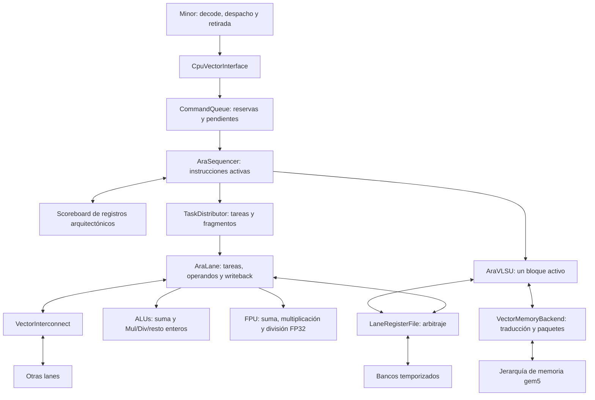

# Hito 2: Concurrencia aritmética, FP32 y recursos temporizados

Estado: diseño propuesto y plan de trabajo. Revisión documental aprobada el
20 de octubre de 2026; no autoriza implementar código ni crear pruebas.

El equipo da por comprobado y cerrado el baseline del hito 1. El trabajo
pendiente se organiza en ocho fases, sin repetir su comprobación. La FPU se
dedica exclusivamente a coma flotante; multiplicación, división y resto
enteros se asignan provisionalmente a la ALU con objetivo de 8/16/32/64 bits.
Sus formas serán vector--vector (`.vv`) y vector--escalar entero (`.vx`);
los perfiles temporales se concretarán en la propuesta de implementación.
Widening y narrowing quedan fuera de este hito y se concretan en el 4.
La interconexión
será modular, con un crossbar inicial y otras topologías para futuros
experimentos. La memoria unit-stride se agrupa por bloques con un único
bloque activo hasta completar sus efectos en memoria y VRF.

Referencias de entrada: [índice del hito 2](README.md),
[baseline del hito 1](../hito1/README.md) y sus
[estadísticas](<../hito1/Estadísticas.md>). La sección 2 conserva la inspección
histórica que motivó el diseño; esta actualización no implementa las
ampliaciones propuestas.

El [plan de evolución de los hitos 2 a 5][plan-evolucion] conserva este
alcance y desarrolla la continuación: el 3 resolverá predicación, chaining,
memoria concurrente y ejecución colectiva. El 4 añadirá precisión mixta,
formatos FP y ampliaciones de datos para HPC/ML; el 5 completará repertorio
y kernels. El [resumen de hitos][resumen-hitos] ofrece una lectura breve.
El 3 también preparará las interfaces para agrupar lanes en clústeres dentro
de una VPU; el 4 recoge un primer experimento con dos clústeres.

Los [objetivos globales de VAMPIRE][objetivos] sitúan este hito como base
para estudiar entrega de datos, RVV+IME y arquitecturas/escenarios CMOS 2.0.
Las restricciones siguientes son de esta entrega, no exclusiones del
proyecto a largo plazo. La interconexión y los recursos deben permanecer
parametrizables: el crossbar y los tamaños iniciales son puntos de partida.

Para seguir el documento:

- Empieza por las secciones 1--4 para conocer objetivos, límites y módulos.
- Consulta las secciones 5--10 para los contratos de datos y recursos.
- Usa las secciones 11--12 para soporte de instrucciones y priorización.
- Sigue las [fases de trabajo](#13-fases-de-trabajo-y-dependencias) de la
  sección 13 para preparar cada propuesta de implementación.
- Las secciones 14--15 relacionan archivos previstos, observabilidad y
  criterios de cierre; las secciones 16--17 explican decisiones y fuentes.

## 1. Objetivo y relación con la primera etapa

Ejecutar varias instrucciones aritméticas vectoriales independientes a la
vez, con enteros de 8/16/32/64 bits y coma flotante de 32 bits (FP32).
Modelar la capacidad y los tiempos de colas, bancos, unidades de cálculo y
red para explicar sus esperas y límites de servicio. La corrección
arquitectónica sigue siendo obligatoria.

Los objetivos son:

- Solapar instrucciones aritméticas independientes. Un consumidor espera
  todos los resultados de su productor; usar resultados parciales
  (chaining) se incorpora en el hito 3.
- Incorporar una FPU por lane para suma, multiplicación y división FP32.
- Ampliar la ALU con multiplicación, división y resto enteros, sin añadir
  unidades dedicadas para esas operaciones en esta iteración.
- Admitir elementos enteros de 8, 16, 32 y 64 bits en aritmética y memoria.
- Agrupar memoria unit-stride en bloques con buffers y accesos al VRF por
  palabra local, conservando una ejecución de memoria serializada.
- Parametrizar bancos, puertos, anchuras y número de ALUs por lane.
- Modelar colas finitas, arbitraje, latencias y contrapresión.
- Añadir una interconexión modular entre lanes, inicialmente con crossbar,
  que permita comparar otras topologías sin cambiar sus consumidores.
- Establecer un procedimiento estable para incorporar instrucciones según
  las necesidades que revele el análisis de benchmarks.

La integración con Minor y el flujo funcional SE del hito 1 son el punto de
partida ya cerrado por el equipo. El trabajo pendiente empieza en la fase 1,
con los contratos del nuevo hito. Cada fase requiere su propuesta de código
y aprobación; este documento sólo organiza el diseño y la implementación
futura.

Este documento amplía las decisiones del baseline únicamente en el alcance
descrito aquí. Las siguientes referencias conservan sus contratos para la
primera etapa:

- [Interfaces propuestas](<../hito1/Interfaces propuestas.md>): responsabilidades,
  identidad, tareas, VRF, memoria, propiedad de mensajes y drain.
- [Plan de integración](<../hito1/Cambios en gem5 v25 versión mejorada.md>): frontera
  con Minor y recorrido funcional de la primera etapa.

Las afirmaciones antiguas sobre módulos vacíos o anchos fijos se deben leer
en el contexto de aquella planificación. La sección siguiente identifica el
punto de partida observado para este nuevo hito.

## 2. Punto de partida de la propuesta: inspección histórica

La tabla recoge la inspección de fuentes de `f2c26f1ef2c3` usada para preparar
la propuesta original. Se conserva como contexto de sus límites técnicos;
no describe una tarea pendiente de comprobación del hito 1 ni sustituye su
documentación actualizada.

| Componente | Situación observada |
| --- | --- |
| `AraSequencer` | Una única entrada `active`; libera la cabeza al cerrar. |
| `TaskDistributor` | Estado activo para una tarea y sus fragmentos. |
| `AraLane` | Un fragmento activo y slots de operandos y resultado. |
| `VectorRegBank` | Un acceso activo, compartido entre lectura y escritura. |
| `LaneRegisterFile` | Concesión por llegada; devuelve `Retry` al competir. |
| `AraVLSU` | Una tarea y un elemento en curso, incluido su acceso al VRF. |
| `VectorMemoryBackend` | Una petición lógica y un paquete físico en vuelo. |
| `VectorSupport` | Contempla elementos de 16 y 32 bits en el backend. |
| `Fpu` | Suma binary16 funcional con redondeo y flags explícitos. |
| Frontera CPU--VPU | No transporta aún contexto FP ni devuelve `fflags`. |
| `VectorInterconnect` | Los archivos `.hh` y `.cc` están vacíos. |

`ExecutionBundle` y `ExecutionResult` contienen patrones de bits en
`std::vector<uint32_t>`. Las máscaras y conversiones dependen de ese límite.
El mapper exige palabras múltiplo de cuatro bytes. Hay una base parcial para
generalizar anchos; ampliar una lista de SEW no resuelve todo el recorrido.

La demora mediante eventos de las unidades actuales asegura progreso
funcional. No debe utilizarse como latencia hardware validada de Ara.

## 3. Alcance, invariantes y exclusiones

Se mantienen estas decisiones:

- Minor decodifica. La VPU recibe `VectorCommand` con semántica y operandos
  resueltos, sin `StaticInst`, `DynInst` ni una segunda decodificación.
- `vsetvli` permanece en CPU. Cada comando conserva su configuración RVV.
- Admisión y comienzo de instrucciones en orden, con retirada en orden en
  Minor. La finalización de instrucciones independientes puede desordenarse.
- Referencias arquitectónicas mediante `VectorRegRef`.
- Identidad completa para comandos, tareas, fragmentos y accesos.
- Aceptar trabajo no equivale a ejecutarlo, entregarlo ni finalizarlo.
- Toda capacidad es finita y toda respuesta aceptada tiene un propietario.

La primera versión concurrente solapa aritmética previamente validada. La
memoria actúa como barrera y ejecuta una sola instrucción, por bloques en
orden. Sólo hay un bloque activo hasta cerrar sus efectos en memoria y VRF.
Los accesos al VRF de ese bloque pueden progresar en paralelo dentro de las
capacidades de bancos y puertos. La interconexión modular y las dos slides
`vslide1up.vx` y `vslide1down.vx` se incorporan sin activar chaining.

Quedan fuera de alcance:

- Renombramiento físico, RAT, free-list y ROB vectorial.
- Chaining, forwarding entre instrucciones y disponibilidad por elemento.
- Issue fuera de orden, bypass de la cabeza y ejecución especulativa.
- Solapamiento aritmética--memoria, varias instrucciones de memoria activas,
  varios bloques activos y varios paquetes físicos de memoria en vuelo.
- Memoria strided, indexed, segmentada o fault-only-first.
- Modelado de los canales AXI y una MMU temporizada equivalente a la de Ara.
- Widening, narrowing, FMA, conversiones y raíces como operaciones activas.
- Unidades dedicadas de multiplicación, división y resto enteros: esas
  operaciones se asignan provisionalmente a la ALU.
- MASKU, SLDU completa, gathers y reducciones.
- Routers, flits, anillos, clusters y topologías de AraXL.
- Activación de lógica en `future/`, cobertura RVV completa y estimación PPA.

Reservar contratos de extensión no significa implementar esas funciones.
Cada ampliación posterior necesita su propuesta y aprobación de código.

## 4. Organización y responsabilidades



El diagrama describe responsabilidades, no el número de instancias C++.
Las dos slides compartirán un ejecutor mínimo que se concretará antes de
implementar su conexión con sequencer, lanes e interconexión. El ejecutor
gestiona el movimiento semántico; la red sólo transporta sus datos.

| Módulo | Responsabilidad en este hito |
| --- | --- |
| `VectorEngine` | Validar parámetros, construir y conectar; coordinar drain. |
| `CpuVectorInterface` | Identidad, validación de frontera y ciclo de vida. |
| `CommandQueue` | Reservas, orden de admisión y créditos globales. |
| `AraSequencer` | Iniciar en orden y agregar cierres por comando. |
| Scoreboard vectorial | Reservas de lectura/escritura y RAW, WAR, WAW. |
| `TaskDistributor` | Distribuir varias tareas sin perder sus identidades. |
| `AraLane` | Contextos, buffers, selección de FU y writeback local. |
| ALUs | Suma y Mul/Div/resto enteros; ocupación por instancia, sin acceso al VRF. |
| FPU | Sólo coma flotante, redondeo y flags; sin acceso directo al VRF. |
| `LaneRegisterFile` | Mapear y arbitrar peticiones a sus bancos. |
| `VectorRegBank` | Aplicar accesos concedidos y devolver sus respuestas. |
| `VectorInterconnect` | Transporte con capacidad y latencia explícitas. |
| `AraVLSU` | Bloques, reunión de stores, reparto de cargas y cierre. |
| `VectorMemoryBackend` | Límites, traducción, paquetes, retry y faults. |

## 5. Anchos de elemento y geometría

### 5.1. Qué significa admitir anchos configurables

Se elimina el supuesto de que todo elemento tiene 32 bits. El primer perfil
admite SEW de 8, 16, 32 y 64 bits, las codificaciones estándar de RVV 1.0.
Los anchos superiores de SEW están reservados en esa especificación; otros
formatos exigirían declarar una extensión, no alterar silenciosamente RVV.

El conjunto de anchos se configura y se comprueba por operación y unidad.
El objetivo de suma, multiplicación, división y resto enteros es admitir
8/16/32/64 bits. La memoria unit-stride comparte esos cuatro anchos. La FPU
se limita a FP32: admitir enteros de 64 bits no habilita automáticamente FP64.
La matriz de la sección 11.3 expresa objetivos del hito, no soporte actual.

| Concepto | Significado |
| --- | --- |
| SEW | Ancho seleccionado para la instrucción. |
| EEW | Ancho efectivo de un operando concreto. |
| LMUL/EMUL | Grupo seleccionado y grupo efectivo por operando. |
| `lane_word_bytes` | Palabra física de banco y unidad del mapper. |
| Ancho de FU | Bytes procesados por bundle en una instancia. |
| VLEN | Capacidad arquitectónica de cada registro vectorial. |

Los contratos describirán EEW/EMUL por operando. La entrega inicial conserva
operaciones de igual ancho y memoria con EEW=SEW. Widening, narrowing y
memoria con EEW distinto podrán añadir sus reglas cuando se aprueben.

### 5.2. Representación y ejecución

El VRF y los mensajes de transporte conservan buffers de bytes. Los bundles
de ejecución deben transportar ancho, formato y operandos sin quedar
limitados por el contenedor actual `uint32_t`.

Los adaptadores funcionales interpretan esos bytes según la operación. Para
los enteros de hasta 64 bits se pueden usar contenedores `uint64_t`; eso es
una decisión local del cálculo, no el formato universal de transporte.

La capa común concentra:

- Número de bytes por elemento y tamaños comprobados de rangos.
- Máscaras y truncamiento al ancho activo, incluido el caso de 64 bits.
- Interpretación con signo y extensión del operando escalar desde XLEN.
- Conversión entre bytes y patrones de bits según el objetivo simulado.
- Adaptadores enteros con truncamiento y casos extremos de división/resto
  explícitos, sin comportamiento indefinido del host.
- Adaptadores FP que mantengan formatos, redondeo y flags explícitos.

No se sustituirán todos los campos `uint32_t` indiscriminadamente: índices,
identidades y tamaños pueden conservarlos si sus límites siguen siendo
válidos. Se revisarán especialmente los contenedores de valores y shifts.

### 5.3. Restricciones iniciales de mapeo

`AddressMapper` sigue siendo la única autoridad para lane, banco, fila y
posición de bytes. El layout físico permanece basado en bytes y palabras;
cambiar SEW no cambia el significado ni la ubicación de los bytes almacenados.
No se introduce el layout dependiente de SEW ni el reshuffle completo de Ara.

El mapeo se construye como una política seleccionable al configurar
`VectorEngine`. La política inicial es el reparto por bytes y palabras de
esta sección. Otra política podrá cambiar la lane, el banco o la fila de los
bytes sin alterar la semántica RVV ni a sus consumidores, que sólo consultan
al mapeador. Este hito no implementa políticas alternativas.

La primera geometría exige que:

- Los elementos admitidos quepan íntegramente en una palabra.
- Cada ancho de elemento habilitado divida `lane_word_bytes`.
- VLEN sea múltiplo de `lane_word_bytes * num_lanes`.
- Las capacidades y grupos se validen para la operación concreta.

Así, habilitar SEW=64 exige palabras de al menos ocho bytes. Reunir un
elemento repartido entre palabras o lanes queda fuera de la primera entrega.
Los LMUL que no alojan un elemento de cierto ancho no tienen por qué excluir
otros anchos; admisión valida la combinación, sin usar un mínimo fijo de 32.

Una palabra de 16 bytes aloja cuatro enteros de 32 bits u ocho de 16. El
distribuidor la divide en bundles según ancho y capacidad de las FUs. El
número de elementos del vector no se confunde con el ancho SIMD del recurso.

### 5.4. Políticas tail y perfil LMUL del hito 2

Para cada operación admitida deben respetarse `tu/ta` desde este hito,
incluidos tail parcial y rangos vacíos. `ta` permite conservar el valor
anterior: admitir agnostic no exige sobrescribirlo ni implementar una
optimización específica. Se capturan `mu/ma`, pero las operaciones
predicadas se incorporan en la fase 3.2. Esa fase definirá su tratamiento
de elementos inactivos y escrituras parciales, preservando las garantías
de tail. Los destinos de máscara tienen sus reglas propias.

La fase 1 fija la matriz inicial SEW×LMUL. **La fase 2 debe cerrar suma y
memoria con `m1/m2/m4/m8` y `mf2/mf4/mf8`** para las combinaciones de ese
perfil legal. Los factores son objetivos acordados, no meros candidatos.
La matriz exacta por operación, SEW y geometría se concreta en la propuesta
de código de fase 1; no se exige combinar indiscriminadamente todos los
anchos con todos los factores. La configuración de referencia del baseline
sólo habilita `m1`; tipos y parámetros no sustituyen evidencia de ejecución.

En fase 2 se incorporan primero grupos enteros, después `mf2` y finalmente
`mf4/mf8`, con una instrucción activa. Las fases 3--5 conservan ese soporte
al temporizar recursos, agrupar memoria y añadir concurrencia. Las fases
6--7 lo extienden a las operaciones añadidas según su formato y legalidad.

Admisión y mapper comprobarán cada combinación según RVV, incluidos
SEW/ELEN, VLMAX, alineación y solapamientos. Para los fraccionales, el
resto del registro contenedor se trata como tail. El scoreboard de este
hito reserva conservadoramente ese contenedor completo. La geometría con
EEW/EMUL distintos se amplía en el 4; el 5 completa la campaña conjunta,
sin aplazar requisitos de combinaciones anunciadas en etapas anteriores.

El [plan global](<../Plan de evolución - Hitos 2 a 5.md#políticas-tailmáscara-y-perfiles-lmul-por-hito>)
detalla el reparto. Referencia normativa: RVV 1.0, [manual oficial][manual-rvv],
edición 20240411, secciones **Vector Tail Agnostic and Vector Mask
Agnostic**, **Vector Register Grouping**, **Mapping for LMUL < 1** y
**Vector Operands**.


## 6. Concurrencia, dependencias y créditos

### 6.1. Estados y capacidad

Se diferencian reserva, aceptación, inicio, finalización y retirada. Una
orden aceptada puede esperar en la FIFO; una activa tiene contexto de
ejecución; una terminada puede seguir retenida en Minor hasta su retirada.

El control de admisión conserva un crédito por comando hasta entregar su
finalización. Mover una orden al estado activo no devuelve ese crédito.

```text
reservas + aceptadas pendientes + activas/cerrando <= command_queue_entries
activas ejecutando <= max_active_commands
```

Los estados son excluyentes para contar cada comando una sola vez. Una orden
cerrando ya no ejecuta, pero conserva crédito hasta completar la notificación.
Minor mantiene además su propio límite de entradas hasta la retirada.

El sequencer inicia desde la cabeza de pendientes. Si faltan dependencias,
contextos o capacidad de destino, esa cabeza espera y no hay bypass. El
trabajo ya iniciado continúa. Antes de iniciar se reservan su contexto y las
obligaciones necesarias para repartirlo sin duplicar tareas ante `Retry`.

Un rango vacío no genera accesos ni paquetes. Su cierre único sigue las
reglas de identidad, créditos y retirada.

### 6.2. Scoreboard arquitectónico conservador

La propuesta introduce un scoreboard activo para este hito, separado de la
tabla granular reservada en `future/`. Registra, por comando, los grupos
leídos y escritos. No asigna registros físicos ni versiones.

- RAW: una fuente espera a todos los writebacks del productor anterior.
- WAR: una escritura espera al cierre del lector anterior del grupo.
- WAW: un escritor espera al cierre del escritor anterior del grupo.
- Lecturas concurrentes del mismo grupo sí pueden coexistir.

Se reservan registros arquitectónicos completos del grupo efectivo. Para
LMUL fraccional se reserva conservadoramente el registro contenedor. Los
grupos parcialmente coincidentes también producen conflicto.

La reserva se realiza al iniciar, comparando sólo con comandos anteriores.
Las lecturas y escrituras de una misma instrucción no se bloquean a sí mismas;
la unidad aplica su orden interno y las reglas legales de solapamiento.
Todas las reservas del comando se liberan después de cerrar tareas y
writebacks. Esto limita el paralelismo, pero evita readiness parcial.

Ejemplo: una suma que escribe `v1` y otra que escribe `v8`, con fuentes
independientes, pueden solaparse. Una suma que consume `v1` espera al cierre
completo de su productor, aunque algunas lanes ya hayan escrito.

## 7. Despacho y retirada en Minor

Ampliar únicamente las colas de la VPU no basta. El despacho desde una sola
cabeza de commit que espera `completed` serializaría toda la ejecución.

La primera integración concurrente separa el cursor de despacho vectorial
de la cabeza de retirada, aprovechando las entradas en vuelo de Minor. Se
propone una ventana acotada de aritmética vectorial consecutiva:

1. Antes de abrirla, todas las instrucciones anteriores han terminado y los
   caminos de control que podrían anularla están resueltos.
2. Se validan legalidad, soporte y operandos de cada instrucción antes de
   solicitar su reserva y despacharla en orden.
3. Cada instrucción conserva `MinorVectorState` y su `CommandKey` hasta
   procesar la finalización y retirarse.
4. El callback guarda la respuesta en su entrada, aunque no sea la cabeza.
5. Sólo la retirada aplica resultados escalares, estado RVV y flags FP en
   orden. No se ejecuta otra vez la instrucción por su ruta nativa.

La ventana inicial no atraviesa instrucciones escalares, cambios de
configuración, CSRs, control, operaciones no soportadas ni memoria. Si una
instrucción joven se rechaza, se detiene el despacho; las anteriores terminan
antes de procesar la excepción local. No se entregan órdenes posteriores.

El solapamiento inicial requiere `vstart=0`. Las instrucciones que necesitan
reinicio con `vstart` no nulo se ejecutan aisladas. Los snapshots de `vl`,
`vtype`, operandos escalares y redondeo no se recapturan tras `Stall`.

### 7.1. Memoria como barrera

Una carga o store vectorial empieza después de retirar las instrucciones
anteriores y cerrar los accesos escalares pendientes relevantes de la LSQ.
Impide despachar trabajo posterior hasta procesar su éxito o fault.

La VLSU sustituye la petición por elemento del baseline por bloques de
elementos contiguos, según la sección 7.3. Mantiene un único bloque activo y
no inicia el siguiente hasta completar sus efectos en memoria y VRF. Se
conservan la respuesta terminal única, el retry timing y la comunicación de
faults a Minor mediante `finalVstart`. Los accesos que no puedan agruparse
con seguridad conservan el recorrido por elemento.

La retirada ordenada no protege por sí sola el VRF: si una instrucción joven
ya escribió, un fault anterior necesitaría recuperación. La barrera evita
ese caso sin añadir rollback o almacenamiento especulativo de resultados.

### 7.2. Flags, interrupciones y drain

El contexto FP se captura en CPU. Los flags se agregan por fragmento, tarea
y comando, y se devuelven a Minor para acumularlos al retirar. No se modifican
CSRs desde callbacks de lanes ni se aplica antes de tiempo el `vstart` de una
instrucción joven. Los accesos a `frm`, `fflags` y `fcsr` cierran la ventana.

Las interrupciones y el descarte deben respetar un punto arquitectónico
seguro: no se anula trabajo ya admitido sin un contrato de recuperación.
La propuesta de código detallará su coordinación con los caminos de Minor.

Drain cierra grants nuevos y deja terminar reservas concedidas, comandos,
fragmentos, lecturas, pipelines, transferencias, writebacks y callbacks.
También exige que Minor procese las finalizaciones retenidas. Ninguna cola
vacía por sí sola demuestra que el sistema esté drenado.

### 7.3. Memoria unit-stride por bloques

La unidad de trabajo interna de la VLSU pasa de un elemento a un rango de
elementos contiguos. `VectorCommand` y `MemoryTask` siguen describiendo la
instrucción completa; el cambio se concentra en la VLSU, sus mensajes de
memoria y el backend. La agrupación conserva EEW=SEW y el soporte de anchos
de la sección 5. No incorpora máscaras de predicación ni nuevos modos de
direccionamiento.

El alcance elegido mantiene una instrucción de memoria, un bloque activo y
un paquete físico en vuelo como máximo. Las colas y buffers tienen capacidad
finita. Preparar metadatos no permite iniciar accesos del siguiente bloque
antes de cerrar el actual. No hay una ventana de cargas pendientes ni
solapamiento con aritmética.

#### 7.3.1. Formación y límites del bloque

El generador de la VLSU parte del siguiente índice absoluto `i`, del tamaño
de elemento `E` y de la base capturada en el comando. La dirección inicial
es `base + i * E`, con el ancho de dirección del objetivo. El rango de VRF
empieza en `i * E`; `vstart` no desplaza la base del vector.

El backend proporciona los tamaños de página y línea como valores del
contexto, sin exponer `ThreadContext`, MMU ni objetos de gem5 a la VLSU. La
configuración fija `memory_max_block_bytes`, cuyo nombre es propuesto. El
bloque se recorta al menor límite y contiene elementos completos:

```text
M = min(bytes restantes, máximo de bloque,
        bytes hasta fin de línea, bytes hasta fin de página,
        bytes hasta fin del espacio de direcciones del objetivo)
elementCount = floor(M / E)
blockBytes = elementCount * E
```

Se comprueban productos, sumas y rangos sin overflow. No se accede a bytes
anteriores a `vstart` ni posteriores a `vl` para rellenar una línea. Un rango
vacío no crea bloques. El bloque final puede ser menor que el máximo.

Si un elemento cruza una frontera y no cabe íntegro, se usa una petición de
un elemento con la fragmentación física del baseline. Después se continúa
agrupando. La traducción verifica también que cada paquete físico respete
su línea. Un bloque puede cubrir varias palabras y lanes del VRF, manteniendo
la restricción de que cada elemento cabe en una palabra local.

Ejemplo con `vl=20`, `vstart=0`, elementos de cuatro bytes, base `0x1000`,
líneas de 64 bytes y máximo de bloque de 64 bytes:

| Bloque | Elementos | Dirección virtual | Bytes |
| --- | --- | --- | --- |
| 0 | 0--15 | `0x1000` | 64 |
| 1 | 16--19 | `0x1040` | 16 |

El camino agrupado requiere dos peticiones frente a las veinte de cuatro
bytes del baseline. Con base `0x1030`, los límites serían un bloque inicial
de 16 bytes y otro de 64. El tamaño de bloque no representa el ancho físico
del bus ni una ráfaga AXI; la jerarquía configurada en gem5 modela el
transporte del paquete.

#### 7.3.2. Mensajes e identidad

El descriptor lógico de memoria distingue tamaño de elemento y tamaño de
bloque. La propuesta de código concretará su representación en
`common/memory_types.hh` y actualizará los validadores y `LoadData`.

| Campo o relación | Contrato propuesto |
| --- | --- |
| `TaskKey`, `requestId` | Identidad del bloque, estable ante retry. |
| Dirección y operación | Dirección virtual inicial y carga/store. |
| `elementBytes` | Tamaño de cada elemento en bytes. |
| `firstElement`, `elementCount` | Rango absoluto de elementos. |
| `size`, `dataRange` | Tamaño del bloque y rango de bytes del VRF. |
| Registro y datos | Referencia arquitectónica y bytes del store. |
| Metadatos CPU | Contexto, PC y `requestorId` originales. |
| Accesos al VRF | `accessId` propio, asociado al bloque y offset de bytes. |

Se exige `size = elementCount * elementBytes` y un `dataRange` con tamaño
`size` y offset `firstElement * elementBytes`. El buffer del store contiene
`size` bytes; en cargas está vacío.

Una petición de bloque no tiene una única `laneId`: sus destinos o fuentes
proceden de `AddressMapper`. Los fragmentos físicos de memoria conservan la
clave del bloque y una correlación privada del backend. Los accesos locales
al VRF tienen identidades distintas de esos fragmentos.

El backend devuelve una sola respuesta terminal por bloque aceptado:
`LoadData` con todos sus bytes, `StoreAck` o `Fault`. La VLSU valida clave,
tamaño y fase antes de consumirla. Los mensajes y buffers aceptados tienen
propiedad definida y sobreviven a todos sus callbacks.

#### 7.3.3. Cargas y reparto al VRF

La VLSU reserva el buffer del bloque antes de enviarlo. El backend traduce y
envía sus paquetes; en el camino agrupado habitual hay un paquete por bloque.
En el camino por elemento fragmentado se traducen los fragmentos antes del
primer envío y se sirven de uno en uno, como en el baseline.

Al recibir todos los bytes de una carga correcta, la VLSU consulta
`AddressMapper` y crea accesos de escritura por palabra local. Cada uno
conserva clave, rango, lane y posición dentro del buffer. No se envía un
acceso de todo el bloque a un LRF, cuya frontera sigue siendo una palabra.

Los accesos a bancos distintos pueden progresar en paralelo según la
capacidad disponible. Un `Retry` conserva sólo el acceso no aceptado; uno
ya aceptado no se vuelve a emitir. La VLSU mantiene los datos y las
asociaciones hasta recibir todos los `WriteAck`. El bloque sólo entonces
termina y el siguiente índice avanza en `elementCount`.

Con cuatro lanes, palabras de ocho bytes y un rango VRF alineado de 64
bytes, un bloque de dieciséis elementos de 32 bits necesita ocho accesos
locales en lugar de dieciséis. Un rango parcial conserva los bytes exteriores
mediante los byte enables. El endianness no depende del host.

#### 7.3.4. Stores y reunión de datos

La VLSU mapea el rango del bloque y reserva su buffer antes de pedir lecturas
al VRF. Cada respuesta se copia al offset asociado a su `accessId`; el orden
de llegada no determina la posición de los bytes. Los datos deben cubrir el
rango exactamente una vez, sin huecos ni duplicados.

Sólo después de recibir todas las lecturas se envía el bloque al backend.
El buffer capturado permanece estable ante retry: no se releen los registros
ni se reconstruyen los datos. Se espera a `StoreAck`, con todos los paquetes
cerrados, antes de preparar accesos del siguiente bloque.

#### 7.3.5. Contrapresión, faults y drain

Se conservan los dos niveles de retry. Si el backend rechaza la petición
lógica, la VLSU mantiene el mismo descriptor y buffer. Una vez aceptada, el
backend gestiona sus paquetes; tras un `sendTimingReq` fallido conserva el
mismo paquete y espera `recvReqRetry`. Un paquete aceptado espera respuesta
y nunca se reenvía por tardar. La recepción se reserva antes de emitir.

El estado mantiene contadores o conjuntos de accesos pendientes. Un bloque
no termina por recibir una única confirmación ni por vaciar una cola de
envío: deben quedar cerrados memoria, lecturas y escrituras del VRF.

La agrupación no garantiza atomicidad de stores ni localización de un byte
fallido a partir de cualquier error del puerto. La propuesta de código debe
definir la RAM agrupable, las garantías de sus respuestas y la asociación
entre dirección de fault, elemento y `finalVstart`. Si no se puede preservar
ese contrato, el acceso usa el recorrido por elemento desde el principio.
No se reenvía un store fallido para intentar localizar la causa.

Al fallar la traducción de una página que contiene todo un bloque, el índice
causante es su primer elemento activo y no se envía ese bloque. Por ejemplo,
con base `0x1FF0`, ocho elementos de cuatro bytes y páginas de 4096 bytes, el
primer bloque completa los elementos 0--3. Si la página de `0x2000` falla,
se comunica `finalVstart=4` sin iniciar elementos posteriores. Para errores
de acceso no se inventa un índice fino que la respuesta no proporciona.

Los bloques anteriores permanecen completados. Una carga fallida no escribe
sus datos al VRF. Antes de comunicar `MemoryFault` se cierran todos los
callbacks y accesos aceptados. Minor procesa la excepción según su contrato;
la VLSU no aplica por su cuenta el estado arquitectónico de la CPU.

Drain cierra la admisión y deja terminar el bloque y el trabajo del comando
ya aceptado. Conserva buffers, traducciones, paquetes, accesos al VRF y
finalizaciones hasta su cierre. No cancela trabajo ni descarta faults.

#### 7.3.6. Beneficios y límites del modelo

Se espera reducir las peticiones pequeñas, las llamadas de traducción y los
accesos al VRF por elemento, y aprovechar palabras, bancos y lanes para
transferir varios elementos. Los buffers permiten retener datos ante
contrapresión y observar por separado las esperas de memoria y del VRF.

La reducción de paquetes no promete una aceleración proporcional ni la misma
reducción de tráfico DRAM: las cachés ya rellenan líneas en sus misses. Una
sola petición de memoria en curso sigue limitando cuánto se puede ocultar
su latencia. Los resultados deben explicarse con bytes, paquetes, accesos y
tiempos de espera del modelo.

El flujo se aproxima a la separación de generación, transferencia y VRF de
Ara. Se conserva el layout por bytes del proyecto y el protocolo timing de
gem5. En RISC-V SE la traducción actual usa la tabla de páginas del proceso;
`translateTiming` no acredita latencias de DTLB o page walks de Ara. La
topología debe concretar el camino vectorial, sus cachés compartidas y la
visibilidad de datos respecto al tráfico escalar.

La fase 4 de la sección 13 organiza este trabajo en subfases revisables.

## 8. Lanes, colas y FPU

### 8.1. Progreso local y propiedad de buffers

Cada lane conserva varios contextos de fragmento. Un contexto identifica
tarea, operandos, fase, FU asignada, resultado y accesos pendientes. Los
operandos se reúnen por identidad y papel, nunca por orden de respuesta.

Las colas finitas se sitúan en el camino de ejecución:

```text
contextos de tareas -> peticiones VRF -> colas de operandos
                                      -> ALUs / FPU
                                      -> colas de resultados -> writeback
```

Una fuente escalar capturada no necesita lectura del VRF. Antes de conceder
una lectura se reserva capacidad para su retorno; antes de iniciar cálculo
se reserva capacidad para su resultado. La reserva puede pertenecer a una
entrada de pipeline o a una cola, pero sólo se cuenta una vez.

Cada FU tiene sus colas o créditos de resultado. Una división FP pendiente no
ocupa el único slot global de todos los cálculos. El arbitraje de writeback
permite que otros resultados progresen cuando sus bancos estén disponibles.

El distribuidor admite varias tareas y agrega fragmentos por `TaskKey`. El
sequencer agrega tareas por `CommandKey`. Un `WriteAck` cierra el writeback
correspondiente, no todas las escrituras del comando.

### 8.2. Organización de la FPU

Se propone una FPU por lane dedicada exclusivamente a coma flotante. Las
ALUs enteras siguen siendo recursos independientes. La FPU no coordina
multiplicadores ni divisores enteros y no tiene rutas de ejecución para
`vmul`, `vdiv`, `vdivu`, `vrem` o `vremu`.

| Operación FP | Forma inicial propuesta | Modelo por concretar |
| --- | --- | --- |
| Suma | `vfadd.vv`, FP32 | Segmentado |
| Multiplicación | `vfmul.vv`, FP32 | Segmentado |
| División | `vfdiv.vv`, FP32 | Multiciclo |

La FPU recibe bundles semánticos con operandos, formato, redondeo e identidad,
y retorna datos y flags con esa misma identidad. No decodifica opcodes,
accede al VRF ni decide dependencias globales. La lane conserva los buffers
y realiza el writeback; Minor aplica los flags al retirar en orden.

El objetivo funcional incluye las tres operaciones FP, pero no obliga a
replicar tres unidades independientes ni fija ahora su organización
interna. La propuesta de código concretará los recursos FP compartidos,
las restricciones entre operaciones y sus créditos. Una FPU ocupada no debe
monopolizar las ALUs ni sus espacios de resultados.

La multiplicación, división y resto enteros se asignan provisionalmente a
la ALU, según la sección 8.3. Una separación futura en unidades dedicadas
requerirá otra propuesta; no forma parte de la organización inicial.

La suma binary16 actual se conserva como capacidad interna. Declarar soporte
arquitectónico FP16 desde CPU exige comprobar la extensión y completar ese
recorrido; no se deduce de disponer del cálculo funcional.

La FPU declara por operación y formato:

- Latencia del resultado, en ciclos del reloj de la VPU.
- Intervalo de iniciación entre bundles.
- Anchura SIMD y máximo de operaciones pendientes.
- Capacidad de entrada y de resultados, con unidad explícita.

Un perfil con latencia 4 e intervalo 1 puede admitir un bundle cada ciclo.
Una unidad multiciclo no segmentada permanece ocupada hasta cerrar su
operación. Los perfiles iniciales son parámetros del modelo, no latencias
hardware verificadas de Ara. La división FP puede empezar con latencia fija
por formato; un algoritmo de latencia dependiente de datos requerirá otro
perfil.

La actividad se programa mediante eventos de gem5, sin esperas del host. La
contrapresión puede detener la FPU al agotar resultados, pero no congela
automáticamente las otras FUs. El inicio global sigue siendo FIFO: la
independencia local no habilita bypass de instrucciones.

### 8.3. Operaciones enteras y varias ALUs

La ALU asume suma, multiplicación, división y resto enteros. La lane envía
la operación semántica y los operandos mediante `ExecutionBundle`, y recibe
`ExecutionResult` con la identidad original. La ALU calcula; no accede al VRF
ni cierra la instrucción. La lane conserva el resultado y completa el
writeback antes de notificar el cierre del fragmento.

El objetivo de suma, multiplicación, división y resto enteros es admitir
8/16/32/64 bits en formas `.vv` y `.vx`. La propuesta de fase 6 concretará
los perfiles temporales para cada ancho. El soporte se valida por
operación, forma y ancho antes de producir efectos; una capacidad interna
no habilita automáticamente una instrucción desde CPU.

Las fuentes vectoriales y el destino conservan el mismo ancho. Suma y
multiplicación guardan los SEW bits bajos; `vmul` no devuelve la mitad alta
ni el producto completo. División y resto siguen la interpretación con o
sin signo de la operación y los casos extremos de RVV, evitando operaciones
indefinidas del host. El [README del hito](README.md#cómo-operan-los-distintos-anchos)
incluye ejemplos numéricos para interpretar esta matriz.

Latencia e intervalo de iniciación se definen por operación. Una división
entera puede ocupar una instancia más tiempo que una suma; no se promete
un ciclo ni admisión simultánea de operaciones en una misma ALU. Las otras
instancias elegibles y la FPU pueden progresar si disponen de operandos y
capacidad. Se respetan los créditos, la contrapresión y drain del recurso.

`alus_per_lane` crea instancias independientes, cada una con ocupación e
identidad de ejecución. La lane asigna bundles elegibles a instancias libres
con política determinista. La división de palabras y fragmentos mantiene
la cobertura exacta de elementos y evita escrituras duplicadas.

Se distingue procesar varios elementos SIMD en una ALU ancha de ejecutar
varios bundles en varias ALUs. Aumentar uno de esos recursos no crea
operandos ni puertos adicionales. La mejora queda limitada por lectura,
writeback, dependencias y capacidad del distribuidor.

## 9. Bancos, puertos y arbitraje

### 9.1. Capacidad física

Se mantiene inicialmente la igualdad entre palabra física del banco y
`lane_word_bytes`. La anchura de cada FU y su número de instancias son
parámetros independientes, compatibles con las restricciones de elementos.

Los bancos admiten puertos dedicados de lectura R, escritura W y compartidos
RW. Cada RW sirve una lectura o una escritura por oportunidad de acceso.

| Perfil | Lecturas/escrituras que puede conceder por oportunidad |
| --- | --- |
| 1RW | Una lectura o una escritura. |
| 1R1W | Una lectura y una escritura compatibles. |
| 2R1W | Hasta dos lecturas y una escritura compatibles. |

Latencia e intervalo de acceso se separan. Un banco segmentado puede admitir
otro acceso antes de responder al anterior si tiene puerto y espacio de
retorno. Un banco no segmentado conserva su ocupación durante la operación.

Como regla inicial, una lectura y una escritura de la misma fila se
serializan hasta cerrar la escritura; también se serializan escrituras con
bytes habilitados coincidentes. No se deja ese comportamiento al orden de
los callbacks. Lecturas compatibles y accesos a otras filas pueden coexistir.

### 9.2. Arbitraje del LRF

El LRF recoge solicitudes persistentes de los emisores y evalúa las
concesiones conjuntamente en el ciclo. Se propone round-robin por banco y
clase de puerto compatible. Las solicitudes de writeback participan con
progreso garantizado; no existe prioridad permanente de lecturas.

Los emisores conservan la petición hasta su concesión. El banco no añade
una FIFO de solicitudes denegadas. El estado del LRF para arbitrar y retornar
accesos concedidos no duplica las colas de operandos o resultados.

La implementación deberá separar registrar una solicitud de concederla si
la API inmediata actual no permite comparar todos los candidatos del ciclo.
Un mensaje aceptado sigue obligando a una única respuesta. El contrato de
frontera y propiedad se concretará en la propuesta de código de esta entrega.

La política no debe depender del orden en que se recorren las lanes o se
invocan callbacks. Tampoco se concede una lectura si no hay espacio reservado
para recibirla. Más puertos no eliminan incompatibilidades ni contrapresión.

### 9.3. Parámetros y validación

Los nombres siguientes son propuestos; los ya existentes conservan su
significado cuando sea compatible. La configuración se fija al construir
`VectorEngine` y permanece inmutable durante la simulación.

La VPU se prepara para ser componible. Cada módulo (lanes, bancos, VLSU,
backend de memoria e interconexión) declara sus propios parámetros y se
instancia desde la configuración, en lugar de depender de una lista plana
de `VectorEngine`. `VectorEngine` valida la combinación y conecta los
módulos. Describir otra organización no debe exigir modificar el código de
los módulos que no cambian. La propuesta de fase 1 decidirá si cada módulo
es un SimObject o recibe una estructura de parámetros.

| Parámetro/familia | Unidad y significado |
| --- | --- |
| `supported_sews` | Conjunto de anchos de elemento, en bits. |
| `command_queue_entries` | Comandos, incluidas reservas y activos/cerrando. |
| `max_active_commands` | Instrucciones ejecutando en la VPU. |
| `minor_vector_window_entries` | Instrucciones retenidas hasta retirada. |
| `lane_task_entries` | Contextos de fragmento aceptados por lane. |
| Buffers de operandos/resultados | Entradas de bundle, por fuente/FU. |
| `memory_max_block_bytes` | Máximo de bytes por bloque de memoria. |
| `lane_word_bytes`, `banks_per_lane` | Anchura de banco y bancos por lane. |
| Puertos R/W/RW por banco | Accesos por oportunidad, según tipo. |
| Latencias/intervalos de banco | Ciclos hasta respuesta y entre accesos. |
| `alus_per_lane` | Instancias de ALU por lane. |
| Anchuras/latencias/intervalos de FU | Bytes por bundle y ciclos. |
| Capacidades de FU | Operaciones pendientes por recurso y clase admitida. |
| Modelo de interconexión | Implementación seleccionada al construir; inicialmente crossbar. |
| Latencia de interconexión | Ciclos de tránsito, sin espera ni servicio. |
| Ancho de banda de interconexión | Bytes por ciclo de origen y destino. |
| Buffers de interconexión | Paquetes y bytes reservados por destino. |

Se validan capacidades positivas, productos sin overflow, formatos
implementados y coherencia con el estado arquitectónico de Minor. Se exige
`max_active_commands <= command_queue_entries`. La ventana CPU puede limitar
el paralelismo efectivo aunque la VPU tenga más entradas.

El máximo de bloque es positivo, aloja al menos un elemento de cada ancho
de memoria habilitado y es divisible por esos tamaños. La entrega mantiene
un único bloque activo y buffers acotados por ese máximo; configurar más
capacidad no habilita varias peticiones de memoria en vuelo. Los bloques
efectivos se recortan según la sección 7.3.1.

Un buffer de bundle declara también su máximo de bytes. No se confunden
entradas de cola con elementos, palabras, paquetes o bytes. Una geometría
inválida falla antes de ejecutar; una operación no soportada se rechaza antes
de reservar; la falta temporal de capacidad produce contrapresión.

## 10. Interconexión modular entre lanes

### 10.1. Modelo inicial

La interfaz de transporte es independiente de la topología. La primera
implementación será un crossbar lógico con conectividad entre cualquier par
de lanes, contención por destino y límite de inyección por origen. No es una
NoC de routers y flits ni una reproducción física exacta de Ara. Las reglas
de arbitraje y servicio siguientes pertenecen a este modelo inicial, no al
contrato que deberán usar todas las topologías futuras.

Cada destino concede servicio mediante round-robin entre orígenes elegibles.
Distintos destinos pueden transferir en paralelo si no superan la capacidad
de sus orígenes. Los límites se aplican a datos reales, no multiplicando una
latencia por el número de lanes.

Para un paquete de `n` bytes y ancho de banda `b` bytes/ciclo, el servicio
ocupa `ceil(n / b)` ciclos. La entrega sucede después del servicio y de la
latencia de tránsito configurada. Se empieza con servicio de un paquete
cada vez por destino, sin entregar fragmentos parciales al receptor.

La aceptación reserva buffers finitos y capacidad en el receptor. Un paquete
que no cabe devuelve `Retry` sin efectos. Los paquetes deben respetar el
máximo de bytes configurado; su productor divide un movimiento mayor en
paquetes identificados. El transporte no introduce flits.

### 10.2. Identidad y contrato de entrega

```text
TransferKey = (TaskKey, transferId)
InterconnectPacket = {
    key, sourceLane, destinationLane, kind,
    sourceRange, destinationReg, destinationRange,
    data, byteEnable
}
```

El propietario de la tarea asigna `transferId` único dentro de `TaskKey`,
también si intervienen varias lanes origen. Los rangos son lógicos y el
mapper resuelve los accesos físicos. Las longitudes de datos y máscara deben
coincidir con el rango transportado.

El productor prepara el paquete después de obtener los datos de origen.
`kind` describe su uso semántico; no contiene un opcode ni ordena a la red
ejecutar una instrucción. No se habilita `operand_forward` entre comandos.

Se distinguen tres acontecimientos:

1. Aceptación: la red posee una copia y las reservas necesarias.
2. Entrega: el receptor posee los datos; el crédito de transporte se libera
   cuando consume el paquete en su capacidad reservada.
3. `WriteAck`: el destino del VRF ya recibió la escritura correspondiente.

La tarea conserva las asociaciones hasta cerrar los accesos. Cada paquete
aceptado tiene una entrega única; `Retry` conserva clave y contenido. Una
marca de último paquete no sustituye contar transferencias pendientes y
comprobar la cobertura del rango. Drain incluye paquetes en cola y tránsito.

### 10.3. Objetivos funcionales: slide1up y slide1down

`vslide1up.vx` y `vslide1down.vx` son objetivos obligatorios de fase 7, en
8/16/32/64 bits y sin predicación (`vm=1`). Su definición sigue el
[manual oficial RVV 1.0, edición 20240411][manual-rvv], secciones **Vector
Slide Instructions**, **Vector Slide1up** y **Vector Slide1down Instruction**.
La selección está cerrada documentalmente; no significa soporte actual.

Sea `s` el escalar capturado por Minor, normalizado a SEW. Para cada índice
activo de destino `i`:

| Operación | Valor escrito |
| --- | --- |
| `vslide1up.vx` | `s` en `i=0`; `vs2[i-1]` en los demás índices activos. |
| `vslide1down.vx` | `s` en `i=vl-1`; `vs2[i+1]` en los demás índices activos. |

Se conserva el ancho y no se realiza cálculo FP. El escalar se extiende con
signo cuando XLEN < SEW y se trunca a los bits bajos cuando XLEN > SEW. El
índice de inserción pertenece al destino: up sólo inserta si el índice 0
está activo; down, si `vl-1` está activo. Con `vl=0` o `vstart>=vl` no se
escribe ningún elemento; hay que resolver ese caso antes de calcular `vl-1`.

El rango activo de destino es `[vstart, vl)`. Las posiciones anteriores no
se modifican y el tail sigue `vta`; conservarlo también es válido bajo la
política agnóstica. Las lecturas de fuente se derivan del desplazamiento,
no de reutilizar ese mismo rango: up puede necesitar `vs2[vstart-1]` cuando
`vstart>0`. Eso no autoriza escribir destinos anteriores a `vstart`. Las
instrucciones con `vstart` no nulo siguen la ejecución aislada de sección 7.

Up exige grupos fuente y destino sin solapamiento; la codificación con
solapamiento está reservada por el manual. Down debe admitir solapamientos
legales, incluido el mismo registro, sin destruir valores que todavía haya
que leer. El scoreboard no resuelve ese riesgo interno. La propuesta de
código definirá captura de fuentes en buffers finitos o una planificación
segura de lecturas/escrituras incluso con entregas de red desordenadas.
No se aplicará a down la prohibición que sólo corresponde a up.

La propuesta de código definirá un ejecutor mínimo compartido que:

- Reciba operación, escalar, referencias y configuración resueltos en CPU.
- Calcule índices/rangos fuente y destino por separado y use
  `AddressMapper` para ubicar cada uno.
- Valide grupos y solapamientos, y preserve fuentes en el caso legal down.
- Separe movimientos locales de transferencias entre lanes; no todos los
  elementos tienen que generar un paquete de red.
- Mantenga `TaskKey`, `TransferKey` y asociaciones con accesos al VRF hasta
  cerrar todos los movimientos y `WriteAck`, incluidos los extremos escalares.
- Respete capacidad, reintento, drain y agregación sin depender del orden de
  respuestas ni de la topología seleccionada.

El ejecutor pertenece a la ruta activa que se proponga, no a `future/`, y
no requiere SLDU completa. El transporte sigue sin ejecutar instrucciones.
Ambas operaciones deben demostrar su recorrido completo; tener sólo el
crossbar o implementar una de las dos no cierra fase 7.

#### 10.3.1. Qué quedará pendiente respecto a RVV

La limitación semántica acordada para estas dos instrucciones al cerrar el
hito es la ausencia de predicación. Sus formas con `vm=0` quedan fuera del
perfil admitido hasta incorporar lectura de `v0`, selección por máscara de
destino y política `vma`. Se identificarán como no soportadas antes de
producir efectos, sin ejecutarlas como si todos los elementos estuvieran
habilitados. No se anunciará soporte completo que incluya máscaras.

`vstart`, rangos vacíos, tail, normalización del escalar y solapamientos
legales de down sí son requisitos de cierre de las formas sin máscara;
no se aplazan como si fueran optimizaciones. Sólo se admitirán geometrías y
grupos dentro del perfil configurado, validando legalidad y capacidad.
El [README](README.md#slides-alcance-al-cerrar-el-hito-y-pendientes-de-rvv)
resume estos compromisos y los casos pendientes.

Slides de distancia variable, formas FP `.vf`, gathers y SLDU completa son
ampliaciones distintas. Tampoco hacen falta otras topologías ni fidelidad de
ciclos con Ara para respetar la semántica de estas dos formas enteras.

### 10.4. Separación entre interfaz y topología

El diseño debe permitir reemplazar el crossbar para realizar experimentos
posteriores sin reescribir lanes, ejecutores ni semántica de instrucciones.
La selección del modelo se realiza al construir `VectorEngine`, no durante
una instrucción activa. La propuesta de código fijará clases y archivos;
esta separación es un requisito del hito, no una segunda topología activa.

| Parte | Responsabilidad |
| --- | --- |
| Interfaz común | Identidad, límites de paquete, admisión, entrega, contrapresión, drain y métricas comunes. |
| Consumidor/productor | Construir e interpretar datos, reservar recepción y cerrar los accesos al VRF. |
| Modelo de red | Conectividad, rutas, arbitraje, buffers, servicio y latencia de tránsito. |
| Configuración | Elegir modelo y parámetros compatibles antes de ejecutar. |

La interfaz expone envíos a un destino lógico y devuelve `Accepted` o
`Retry`. Un rechazo no adquiere propiedad ni produce efectos; tras aceptar,
el modelo mantiene los datos hasta una única entrega. Se debe definir cómo
el emisor vuelve a ser elegible tras un rechazo, sin depender de una llamada
privada del crossbar. Receptor y emisor correlacionan respuestas mediante
`TransferKey`; no asumen orden de llegada ni visibilidad de rutas internas.

El modelo declara sus capacidades, incluido el máximo de bytes por paquete.
Los productores respetan ese límite mediante fragmentos identificados. Las
reservas de recepción y las garantías de progreso evitan que cambiar el
modelo introduzca dependencias ocultas. Drain consulta tanto las reservas
comunes como las colas, eventos y transferencias internas del modelo elegido.

Esta separación será la base para preparar clusterización en el hito 3:
agrupar lanes y recursos locales manteniendo una única VPU. El diseño del
2 no activa clústeres; su transporte no debe incrustar la hipótesis de que
todos los consumidores comparten directamente los recursos de todas las
lanes. El plan de evolución concreta identidad, ubicación y control global
que se separarán en esa siguiente etapa.

Las métricas comunes definen las mismas unidades y puntos de medida:
paquetes aceptados/entregados, bytes, espera de admisión, latencia observada
y ocupación. Una topología futura puede añadir saltos o conflictos de enlace
como métricas propias, sin cambiar el significado de los contadores comunes.
Variar sólo la latencia de un crossbar no equivale a comparar topologías.

Toda topología publica además el tráfico por enlace: bytes y paquetes por
par origen--destino, clasificados como locales o remotos según la ubicación
de los participantes. Al compartir unidades, estas métricas permiten
comparar organizaciones distintas sobre la misma carga.

En este hito se documenta e implementará únicamente el crossbar detrás de
la interfaz. Anillos, mallas y otros modelos requerirán propuestas propias,
con recursos, rutas, progreso y validación definidos. Los ejecutores de
instrucciones mantendrán el mismo contrato de envío y recepción.

## 11. Extensibilidad del conjunto de instrucciones

### 11.1. Descripción semántica y autoridad de soporte

`VectorSupport` será la autoridad compartida para comprobar capacidades.
Se ampliará con descripciones semánticas, por ejemplo `OperationTraits`,
sin copiar listas independientes en frontend, lanes y admisión.

| Metadato de operación | Consumidor y finalidad |
| --- | --- |
| Fuentes/destinos y roles | CPU, tareas y scoreboard. |
| Anchos y formatos admitidos | Admisión y adaptadores funcionales. |
| EEW/EMUL por operando | Grupos, rangos y restricciones de solapamiento. |
| Clase de ejecución | Selección de ALU, FPU o unidad global aprobada. |
| Contexto requerido | Captura de redondeo y estado en CPU. |
| Efectos y faults posibles | Barreras y tratamiento arquitectónico. |
| Perfil temporal por ancho | Recursos y calendario de la unidad. |

Una operación semántica puede representar varias formas de instrucción.
Por ejemplo, la suma comparte cálculo entre fuentes vectoriales y escalares;
la CPU normaliza la forma antes de entregar el comando. La descripción no
extrae bits de instrucciones ni reemplaza la decodificación de gem5.

Los contratos documentarán fuentes adicionales y lectura del destino para
operaciones destructivas. La propuesta de código decidirá si se requieren
operandos tipados adicionales o una colección tipada, manteniendo validación
estructural. No se asume para toda operación que hay exactamente dos fuentes
con igual EEW ni se implementa FMA para preparar esa extensión.

También se distinguirán tipos de resultado y efectos: vector, máscara o
escalar hacia CPU. En este hito sólo se ejecutan las clases de su matriz;
las máscaras y los resultados escalares son puntos de ampliación para el
3. La autoridad de soporte debe poder rechazarlos explícitamente, sin
atribuir soporte por disponer de un descriptor genérico.

### 11.2. Procedimiento para añadir una operación

1. Identificar benchmark, forma y ancho requeridos, y consultar su semántica.
2. Definir operandos, grupos, efectos, unidad y capacidades.
3. Presentar la propuesta de código, incluidos archivos y validación sugerida.
4. Tras aprobarla, añadir la traducción semántica en CPU.
5. Registrar soporte y añadir el adaptador de cálculo y su perfil temporal.
6. Reutilizar tareas, dependencias, transporte y cierres de su familia.
7. Actualizar la matriz de soporte y documentar comprobaciones realizadas.

Para una operación de una familia existente no debería ser necesario cambiar
el arbitraje, el control de créditos ni el algoritmo del sequencer. Una nueva
familia, como reducciones, puede necesitar módulos y contratos adicionales.
La extensibilidad no implica que cualquier opcode se añada sólo con una fila.

### 11.3. Matriz funcional propuesta

Todas las filas son objetivos o candidatos; no son afirmaciones de soporte
actual. El subconjunto aprobado para implementar se concretará por fase.

| Familia | Formas propuestas | Anchos iniciales |
| --- | --- | --- |
| `vadd` | `.vv`, `.vx` | Enteros 8/16/32/64 |
| `vmul` en ALU, bits bajos | `.vv`, `.vx` | Enteros 8/16/32/64 |
| `vdiv`, `vdivu` en ALU | `.vv`, `.vx` | Enteros 8/16/32/64 |
| `vrem`, `vremu` en ALU | `.vv`, `.vx` | Enteros 8/16/32/64 |
| `vle` / `vse` unit-stride | EEW igual a SEW | 8/16/32/64 |
| `vfadd`, `vfmul`, `vfdiv` | `.vv` | FP32 |
| `FloatAdd` interno existente | Dos fuentes vectoriales | Binary16 |
| `vslide1up`, `vslide1down` | `.vx`, sin predicación | Enteros 8/16/32/64 |

FP64 y las formas `.vf` quedan pendientes de selección y aprobación. La ruta
FP exige capturar el contexto y devolver flags hasta CPU antes de anunciar
soporte arquitectónico. La suma binary16 interna no es un objetivo nuevo de
offload FP16.

`vmul`, `vdiv`, `vdivu`, `vrem` y `vremu` se asignan a la clase de ejecución
ALU en la fase 6, con formas `.vv` y `.vx` en 8/16/32/64 bits. Sus perfiles
temporales se concretarán al proponer su implementación. Esta asignación
es provisional; no exige nuevas unidades dedicadas ni impide separarlas
en otro hito. No incluye multiplicación de mitad alta ni widening.

`vsetvli` permanece en CPU. Las formas `.vv` utilizan dos fuentes vectoriales
y las `.vx` un vector y un escalar normalizado por CPU según RVV. En memoria
se contemplan `vle8/16/32/64.v` y `vse8/16/32/64.v` con EEW=SEW. Los grupos
y configuraciones siguen sujetos a legalidad y geometría; una columna de
ancho admitido no habilita todas las combinaciones de LMUL o predicación.

El [README](README.md#instrucciones-y-anchos-previstos-al-terminar-el-hito-2)
ofrece la matriz por ancho y explica qué produce cada operación. Todas las
operaciones aritméticas de este alcance conservan el ancho de sus elementos:
un producto de 16 bits devuelve 16 bits bajos, no un destino de 32 bits.
Widening y narrowing se reservan para un hito posterior.

## 12. Selección de próximas instrucciones con benchmarks

La campaña acordada comprende micro-kernels RVV, kernels de álgebra lineal
densa de BLIS y bloques CSA/HCA de DeepSeek V4 Flash. Sus fuentes, fichas y
distribución están en el [plan de benchmarks][benchmarks]. Esa selección
sustituye los ejemplos genéricos anteriores, sin ampliar el repertorio
comprometido para el hito 2.

Los micro-kernels cubren loads/stores unit-stride, strided e indexed,
gathers, máscaras, reducciones, permutaciones, widening, LMUL, `vsetvl` y
tail. Cada familia se ejecutará cuando su soporte esté disponible según el
plan; nombrarla no la incorpora al 2. La integración de BLIS y de los
bloques CSA/HCA se completa en el 5 sobre los perfiles numéricos del 4.

El análisis se prepara documentalmente; no se ejecuta ni se añaden scripts
o pruebas en esta entrega. Se propone registrar:

| Campo | Utilidad para priorizar |
| --- | --- |
| Benchmark y ROI | Separar kernel de inicialización y biblioteca. |
| Fuente y revisión | Fijar BLIS/Flash, adaptación y etapas incluidas. |
| Instrucción y forma | Identificar la operación realmente necesaria. |
| Frecuencia dinámica | Cuántas veces se ejecuta en la ROI. |
| SEW, EEW y LMUL/EMUL | Elegir las combinaciones que hay que soportar. |
| Máscaras y addressing | Detectar dependencias de familias aún ausentes. |
| Estado de soporte | Completo, parcial o ausente en CPU/backend. |
| Coste y recurso dominante | Cómputo, memoria, VRF, red o dependencias. |
| Trabajo requerido | Adaptador, extensión de familia o nuevo módulo. |
| Prioridad acordada | Beneficio esperado y coste de implementación. |

Una instrucción poco frecuente puede desbloquear un benchmark completo.
Frecuencia y porcentaje de tiempo tampoco son equivalentes. La selección
combina necesidad funcional, impacto, reutilización y esfuerzo.

Para cada siguiente operación se preparará una ficha con fuente semántica,
operandos, anchos, unidad, temporalización, efectos, archivos previstos y
recorrido de validación sugerido. Esta ficha forma parte del procedimiento
de propuesta y aprobación, no de un mecanismo de registro de plugins.

## 13. Fases de trabajo y dependencias

El baseline del hito 1 ya está comprobado y cerrado. No hay fase 0 ni una
nueva entrega para validarlo: el trabajo comienza en los contratos del
hito 2. Las fases siguientes desarrollan las entregas del plan anterior,
conservando su numeración del 1 al 8.

Cada fase debe concretarse en una propuesta de código aprobada antes de
modificar fuentes. Las tareas, interfaces y criterios siguientes permiten
prepararla y revisar su resultado; no autorizan implementaciones ni crean
pruebas. Las comprobaciones sugeridas se acordarán con el equipo.

| Fase | Resultado que deja preparado |
| --- | --- |
| [1. Contratos](#131-fase-1-contratos-y-capacidades) | Datos, soporte, estados, identidades y capacidades coherentes. |
| [2. Anchos](#132-fase-2-generalización-de-anchos) | Suma y memoria de 8/16/32/64 bits con grupos enteros y fraccionales del perfil SEW×LMUL fijado en fase 1. |
| [3. Recursos](#133-fase-3-recursos-temporizados-y-arbitraje) | Colas, bancos y puertos finitos con contrapresión. |
| [4. Memoria por bloques](#134-fase-4-memoria-unit-stride-por-bloques) | Buffers y accesos al VRF por palabra, con un bloque activo. |
| [5. Concurrencia](#135-fase-5-concurrencia-desde-minor-hasta-las-lanes) | Varias instrucciones independientes y retirada ordenada. |
| [6. FPU y ALUs](#136-fase-6-fpu-y-varias-alus-por-lane) | FP32, Mul/Div/resto enteros en ALU y varias instancias. |
| [7. Interconexión](#137-fase-7-interconexión-y-operación-entre-lanes) | Transporte modular y ambas slide1 `.vx` en 8/16/32/64 bits. |
| [8. Extensión y cierre](#138-fase-8-extensión-observabilidad-y-cierre) | Soporte documentado y procedimiento para la siguiente operación. |

El orden de integración previsto es 1 → 2 → 3 → 4 → 5 → 6 → 7 → 8. La fase 4
usa el transporte de anchos y los recursos definidos en 2--3; la fase 5
preserva su barrera de memoria. Las fases 6--7 reutilizan contextos,
reservas, buffers y cierres de las anteriores. Estudiar una fase posterior
no habilita su lógica antes de cerrar las dependencias necesarias.

La matriz de soporte, las fichas de operaciones y la observabilidad se
actualizan en cada fase. La fase 8 consolida ese trabajo; no lo aplaza hasta
el final. La fase 6 incorpora Mul/Div/resto enteros en la ALU, sin unidades
dedicadas adicionales.

### 13.1. Fase 1: contratos y capacidades

**Objetivo y entrada.** Convertir los requisitos de las secciones 5--11 en
contratos compartidos antes de cambiar los recorridos de ejecución. Se
parte de las interfaces existentes, sin ampliar todavía la ejecución.

**Trabajo que realizar.**

1. Revisar `VectorCommand`, tareas, bundles y resultados. Precisar qué
   campos describen operación, roles de operandos, SEW/EEW, LMUL/EMUL,
   formato, rango y destino. Separar datos transportados de metadatos.
2. Definir el transporte de bytes y los adaptadores de cálculo. Documentar
   tamaño, orden de elementos y propiedad de cada buffer, incluidos los
   operandos escalares que Minor captura una sola vez.
3. Establecer una autoridad de soporte en `VectorSupport`, con metadatos
   compartidos cuando convenga. Distinguir combinación ilegal, operación
   no soportada y recurso temporalmente ocupado; sólo el último se reintenta.
   Fijar la matriz SEW×LMUL de suma y memoria para los factores acordados
   `m1/m2/m4/m8` y `mf2/mf4/mf8`, con restricciones de SEW/ELEN y geometría.
4. Especificar reservas, aceptación, inicio, resultado, writeback,
   finalización y retirada. Para cada transición, identificar quién conserva
   el contexto y cuándo libera su crédito. Incluir respuestas síncronas.
5. Fijar la correlación entre `CommandKey`, `TaskKey`, fragmentos,
   `VrfAccessKey` y `requestId`. Preparar los descriptores de bloques y las
   obligaciones de cierre sin activar aún memoria por bloques.
6. Describir captura de redondeo y retorno de flags en la frontera CPU--VPU.
   Definir unidades y restricciones de parámetros: elementos, bytes,
   entradas, ciclos, latencia e intervalo de iniciación.
7. Definir la interfaz común de interconexión y sus capacidades, identidad,
   admisión, reintento, entrega, drain y observabilidad. Distinguir esos
   contratos del arbitraje y las rutas propios de cada modelo de red.
8. Documentar los puntos de ampliación para fuentes adicionales, lectura
   del destino, máscaras y resultados escalares. Separar representación
   semántica y soporte activo, sin habilitar esas familias ni sus recursos.
9. Definir la construcción configurable de la sección 9.3: qué módulos se
   instancian desde la configuración, sus parámetros propios, la política
   de mapeo y cómo se conectan. No se habilitan organizaciones nuevas.

**Módulos e interfaces.** `common/`, `interface/`, `VectorEngine` y el
adaptador de Minor. Los mensajes compartidos no exponen `StaticInst` ni
`DynInst`; ALU y FPU reciben semántica ya resuelta, no opcodes.

**Resultado y cierre.** Una relación de mensajes, capacidades y estados que
permita seguir un comando y sus recursos desde admisión hasta retirada.
Cada respuesta tiene receptor y espacio reservado; cada crédito tiene un
único momento de liberación. Las propuestas posteriores referencian estos
contratos en lugar de introducir versiones incompatibles.

**Comprobación sugerida y límites.** Revisar recorridos de éxito, `Retry`,
rechazo y rango vacío sobre los contratos. Esta fase no activa concurrencia,
nuevas operaciones ni lógica en `future/`.

### 13.2. Fase 2: generalización de anchos

**Objetivo y entrada.** Aplicar los contratos de fase 1 al recorrido completo
de suma entera y memoria unit-stride para 8, 16, 32 y 64 bits. La memoria
continúa por elemento y se mantiene una instrucción activa.

**Trabajo que realizar.**

1. Localizar supuestos de cuatro bytes y contenedores de valores de 32 bits
   en Minor, soporte, tareas, distribuidor, lane, ALU, VLSU y mapper. Mantener
   índices o identidades cuyo tamaño siga siendo válido.
2. Sustituir el límite de transporte de valores por buffers de bytes con
   ancho explícito. Centralizar empaquetado, extracción, máscaras y
   truncamiento; tratar el caso de 64 bits sin shifts inválidos del host.
3. Adaptar `vadd.vv` y `vadd.vx`: captura desde XLEN, extensión o truncamiento
   del escalar y aritmética módulo el ancho activo. La CPU traduce cada
   forma RVV a la operación semántica correspondiente.
4. Extender carga y store por elemento con EEW=SEW. Precisar tamaños,
   offsets, rangos parciales y conversión de bytes sin depender del host.
5. Revisar `AddressMapper` y la validación de geometría: elemento íntegro en
   palabra, divisibilidad, VLEN y grupos efectivos. Cambiar SEW reinterpreta
   los bytes; no redistribuye el VRF ni introduce reshuffle.
6. Integrar grupos enteros `m1/m2/m4/m8`; después `mf2` y finalmente
   `mf4/mf8`, según la matriz de fase 1. Resolver límites entre registros,
   alineación, capacidad efectiva y tail del contenedor fraccionario.
7. Actualizar capacidades por operación/ancho y documentar las combinaciones
   que se rechazan antes de iniciar trabajo.

**Módulos e interfaces.** El formato acordado atraviesa Minor, comandos,
tareas, `ExecutionBundle`/`ExecutionResult`, VRF y memoria. El mapper sigue
siendo la única autoridad de ubicación; la ALU interpreta los datos locales.

**Resultado y cierre.** El mismo camino de suma, carga y store representa
los cuatro anchos sin asumir 32 bits en un paso intermedio. Las referencias
arquitectónicas y los bytes ajenos al rango mantienen su significado.
Los grupos enteros y fraccionales acordados deben recorrer suma, carga y
store en todas las combinaciones de la matriz de fase 1, con una sola
instrucción activa. Su soporte funcional no se aplaza hasta la temporización
o concurrencia; las fases posteriores deben conservarlo y extenderlo a sus
nuevas operaciones según el formato.

**Comprobación sugerida y límites.** Comparar resultados por ancho, cambios
de SEW, escalar negativo, rangos vacíos y finales parciales; revisar límites
de grupos y geometrías inválidas. Incluir cruces entre registros en `m4/m8`
y conservación del tail del registro contenedor en fraccionales. La
evidencia se acordará con el equipo antes de crear pruebas.
Admitir enteros de 64 bits no habilita
FP64, widening, narrowing ni elementos repartidos entre palabras.

### 13.3. Fase 3: recursos temporizados y arbitraje

**Objetivo y entrada.** Convertir las capacidades de fase 1 en recursos
finitos y temporizados sobre los caminos de datos de fase 2. Se mantiene la
ejecución de una sola instrucción para aislar este cambio de la concurrencia.

**Trabajo que realizar.**

1. Parametrizar bancos, palabra, puertos R/W/RW, latencia e intervalo de
   acceso. Rechazar geometrías incoherentes al construir `VectorEngine`.
2. Hacer que `LaneRegisterFile` arbitre por banco y puerto entre operandos,
   writebacks y VLSU. Definir round-robin y orden de conflictos sobre los
   mismos bytes, sin crear una cola oculta de peticiones denegadas.
3. Mantener las peticiones rechazadas en su emisor con identidad y contenido
   estables. Un `Retry` no consume crédito de una operación aceptada ni
   genera otra petición lógica.
4. Introducir capacidades explícitas de operandos, operaciones y resultados.
   Reservar recepción antes de leer y resultado antes de ejecutar, de modo
   que un retorno no dependa de encontrar un hueco imprevisto.
5. Programar servicio y respuestas con eventos. Diferenciar tiempo hasta
   resultado de frecuencia de admisión y conservar los datos bajo bloqueo.
6. Ampliar drain y estadísticas para incluir reservas, accesos, eventos,
   respuestas y resultados todavía retenidos.
7. Añadir contadores por recurso: accesos concedidos por banco, puerto y
   anchura, para atribuir el tráfico del VRF en cualquier organización.

**Módulos e interfaces.** `VectorEngine`, parámetros, `AraLane`,
`LaneRegisterFile`, `VectorRegBank`, ALU y solicitantes de la VLSU. Se
conservan `VrfAccessKey`, respuestas de lectura y `WriteAck` separados de la
concesión de puerto.

**Resultado y cierre.** Las solicitudes compiten por recursos declarados y
se conservan mientras esperan. No se supera ningún puerto o buffer; el
arbitraje permite progreso y el estado drenado incluye las respuestas.

**Comprobación sugerida y límites.** Observar colisiones de banco, presión
de writeback, colas llenas y combinaciones de puertos. Esta fase modela
recursos locales; no añade instrucciones simultáneas ni mejora garantizada.

### 13.4. Fase 4: memoria unit-stride por bloques

**Objetivo y entrada.** Sustituir peticiones por elemento por rangos
agrupables, usando los anchos de fase 2 y los recursos de fase 3. Se conserva
una instrucción de memoria, un bloque activo y un paquete físico en vuelo.
La sección 7.3 fija el comportamiento; estas subfases ordenan su desarrollo.

**4A. Contrato de bloque y faults.** Precisar descriptor, dirección, rango
de elementos, tamaño, datos, identidad y respuesta terminal. Establecer
límites de bloque/línea/página y criterios de memoria agrupable. Definir qué
fallos permiten localizar el elemento causante y cuándo se debe elegir el
recorrido por elemento desde el principio. No reemitir stores para sondear
un fallo.

**4B. Generación.** Recorrer `[vstart, vl)` y construir bloques consecutivos
sin huecos ni solapamientos. Recortar por los límites acordados, capacidad,
desalineación y final parcial; comprobar overflow de dirección. Un rango
vacío no emite peticiones. El siguiente bloque sólo prepara accesos cuando
el actual haya cerrado memoria y VRF.

**4C. Backend.** Admitir el descriptor completo con espacio para su retorno.
Traducir y generar los paquetes necesarios, conservando un único paquete
físico en vuelo. Separar el rechazo lógico del retry del puerto de gem5:
una petición aceptada no se vuelve a admitir, y un paquete enviado no se
reenvía por tardar. Devolver una sola respuesta terminal al cerrar todo.

**4D. Datos y VRF.** Reservar buffers finitos de carga/store y mapear el
bloque por palabras locales. Para stores, reunir lecturas por `accessId`
y offset antes de emitir memoria, conservando el buffer ante retry. Para
cargas, repartir bytes por destino y esperar todos los `WriteAck`. Las
respuestas desordenadas no alteran la posición de los datos. Cada byte del
rango se cubre exactamente una vez y se preservan los bytes no habilitados.

**4E. Integración y observabilidad.** Mantener el camino de memoria acordado
con Minor, el orden escalar/vectorial, `finalVstart`, los faults y drain.
Registrar elementos y bytes por bloque, paquetes, accesos al VRF y esperas
por causa. Distinguir peticiones lógicas de reintentos y fragmentos físicos.

**Módulos e interfaces.** `AraVLSU`, `VectorMemoryBackend`, mensajes de
memoria, mapper y LRF. `MemoryTask` describe la instrucción; cada bloque
viaja con `(TaskKey, requestId)` y conserva sus accesos al VRF asociados.
Minor recibe la finalización de comando, no las respuestas de cada bloque.

**Resultado y cierre.** Recorrido agrupado en los cuatro anchos, con fallback
definido y cierre exacto antes del siguiente bloque. No quedan callbacks,
paquetes ni escrituras pendientes al comunicar una finalización o fault.

**Comprobación sugerida y límites.** Revisar línea/página, finales parciales,
distribución entre bancos/lanes, retry, faults y drain. El caso de veinte
elementos alineados de 32 bits y máximo/línea de 64 bytes debe formar dos
bloques. No se añaden bloques concurrentes, predicación ni nuevos modos de
direccionamiento, y menos paquetes no implica menos tráfico DRAM.

### 13.5. Fase 5: concurrencia desde Minor hasta las lanes

**Objetivo y entrada.** Solapar instrucciones aritméticas independientes
conservando orden de inicio y retirada. Se parte de recursos finitos y de la
memoria por bloques serializada; la suma ya soportada permite desarrollar
el control sin depender todavía de la FPU.

**5A. Control de comandos y dependencias.** Sustituir el único contexto
activo por una colección acotada y mantener el crédito hasta entregar
finalización. Añadir scoreboard de grupos arquitectónicos para RAW, WAR y
WAW, con lecturas compartidas y reserva conservadora de grupos coincidentes.
Iniciar sólo la cabeza elegible; no hacer bypass ni reservar contra sí misma.

**5B. Distribución y ejecución local.** Dar estado independiente a cada
tarea y fragmento en distribuidor y lanes. Correlacionar lecturas, cálculo,
resultados y writebacks por clave; reservar destinos antes de aceptar.
Liberar las reservas del comando sólo al cerrar todas sus obligaciones,
sin confundir un `WriteAck` con el cierre de toda la instrucción.

**5C. Despacho y retirada en Minor.** Separar cursor de despacho y cabeza de
retirada dentro de la ventana aritmética consecutiva de la sección 7.
Capturar operandos y configuración una vez, despachar en orden y retener
cada respuesta en su entrada. Retirar en orden sin ejecutar también la
ruta nativa. Parar ante instrucciones escalares, configuración, control,
CSRs, memoria o rechazo; las instrucciones con `vstart` no nulo van aisladas.

**5D. Barreras y cierre.** Abrir la ventana sólo en un punto seguro; memoria
espera el trabajo anterior y bloquea el posterior hasta resolver éxito o
fault. Concretar interrupciones, squash y drain con las obligaciones ya
aceptadas, sin descartar trabajo que haya alterado el VRF. Incorporar causas
de bloqueo, ocupación y momentos de inicio/finalización a las estadísticas.

**Módulos e interfaces.** `CommandQueue`, `AraSequencer`, scoreboard,
`TaskDistributor`, `AraLane` y Decode/Execute/estado vectorial de Minor.
`CommandKey` identifica la entrada de CPU hasta retirada; la finalización
de VPU puede llegar desordenada, pero sus efectos de CPU se aplican en orden.

**Resultado y cierre.** Dos instrucciones independientes del programa tienen
intervalos activos solapados. Los consumidores esperan todos los writebacks
del productor y se respetan WAR/WAW. Tener varias entradas sólo en el backend
no basta para cerrar la fase: Minor debe despachar más de una instrucción.

**Comprobación sugerida y límites.** Contrastar sumas independientes con
productor--consumidor, grupos parcialmente coincidentes, límite de créditos,
respuestas desordenadas y memoria como barrera. No se introduce chaining,
renombramiento, ROB vectorial ni recuperación de escrituras especulativas.

### 13.6. Fase 6: FPU y varias ALUs por lane

**Objetivo y entrada.** Incorporar FP32 de extremo a extremo y permitir
varias instancias de ALU sobre los contextos y contratos ya concurrentes.
La FPU y las ALUs son recursos independientes. Mul/Div/resto enteros se
incorporan provisionalmente a la ALU; la FPU conserva sólo operaciones FP.

**6A. Semántica y adaptadores FP.** Ampliar la FPU existente para los objetivos
`vfadd.vv`, `vfmul.vv` y `vfdiv.vv` FP32. Precisar resultados, modos de
redondeo, casos especiales y flags con fuentes semánticas acordadas. Mantener
patrones de bits y evitar depender del redondeo implícito del host. La suma
binary16 interna no habilita offload FP16.

**6B. Frontera CPU y retirada.** Completar la traducción semántica en Minor,
las comprobaciones de legalidad y estado FP, y la captura del redondeo al
crear el comando. Propagar contexto hasta los bundles; agregar flags por
fragmento, tarea y comando, excluyendo elementos no ejecutados. Devolverlos
en la finalización y aplicarlos al retirar. Los CSRs FP cierran la ventana;
ningún callback de lane modifica directamente el estado FP de CPU.

**6C. Temporalización y contrapresión FP.** Fijar latencia, intervalo de
iniciación, ancho SIMD, capacidad y recursos compartidos por operación.
Concretar si hay pipelines distintos o exclusión entre operaciones dentro
de la FPU, sin dar por obligatoria una subunidad por operación. Reservar
resultados antes de admitir, retenerlos ante bloqueo y ampliar drain a todos
los eventos. Una división FP larga no retiene los créditos de las ALUs.

**6D. Operaciones enteras en ALU.** Incorporar multiplicación de bits bajos,
división y resto en 8/16/32/64 bits, tanto en forma `.vv` como `.vx`.
Definir semántica con/sin signo, truncamiento y casos extremos sin
operaciones indefinidas del host. Añadir traducción semántica en Minor,
soporte compartido y cálculo en ALU, reutilizando bundles, resultados y
writeback. Precisar latencia, intervalo y ocupación por operación; una
división larga puede bloquear esa instancia, pero no debe retener los
créditos de las demás ni de la FPU.

**6E. Varias ALUs.** Crear `alus_per_lane` instancias con ocupación propia,
reparto determinista de bundles y cobertura exacta de elementos. Distinguir
número de ALUs de ancho SIMD. Arbitrar los resultados de ALUs y FPU hacia el
writeback compartido, sin confundir independencia de cálculo con puertos
ilimitados de VRF.

**Módulos e interfaces.** FPU, ALUs, `AraLane`, soporte, configuración,
mensajes FP y adaptador/retirada de Minor. Las unidades reciben
`ExecutionBundle` y devuelven `ExecutionResult` con la clave original; la
lane hace el writeback y el sequencer sólo cierra después de confirmarlo.

**Resultado y cierre.** Las tres operaciones FP32 recorren CPU--FPU--VRF
con redondeo y flags correctos hasta retirada. FPU y ALUs pueden progresar
independientemente si hay operandos y capacidad; aumentar ALUs preserva el
resultado y permite explicar los límites de utilización.

Las operaciones enteras recorren CPU--ALU--VRF en los cuatro anchos y la
matriz recoge sus formas y perfiles. Las combinaciones no implementadas se
rechazan antes de producir efectos; no se anuncia soporte completo por
haber asignado la familia a la ALU.

**Comprobación sugerida y límites.** Acordar casos FP de redondeo, NaNs,
infinitos, ceros con signo, subnormales y flags; observar una división FP
junto a una suma entera independiente y presión de writeback. Para la ALU,
acordar multiplicación con truncamiento, división/resto con y sin signo,
división por cero y overflow con signo en los cuatro anchos. Observar
ocupación y progreso de otras instancias ante una división entera larga.
FMA, FP64, conversiones, raíces y formas `.vf` permanecen fuera del alcance
inicial.

### 13.7. Fase 7: interconexión y operación entre lanes

**Objetivo y entrada.** Incorporar la interfaz modular de la sección 10, su
primer modelo crossbar y ambas slides enteras `.vx` en 8/16/32/64 bits, sin
predicación. Se reutilizan identidad, buffers y cierre de tareas; la red no
reemplaza los accesos locales de memoria de fase 4.

**Trabajo que realizar.**

1. Traducir `vslide1up.vx` y `vslide1down.vx` en Minor y registrar sus
   capacidades. Aplicar sección 10.3: escalar desde XLEN, índices activos,
   `vstart`, tail y validación de grupos/solapamiento antes de iniciar.
2. Concretar el propietario de ese ejecutor y las transferencias necesarias:
   origen, destino, rango, bytes habilitados, datos y `TransferKey`.
   Determinar cómo se preservan fuentes y destinos coincidentes.
3. Separar interfaz común y modelo seleccionable desde configuración.
   Implementar el crossbar con buffers/créditos finitos, límite por origen y
   arbitraje round-robin por destino. Separar servicio en bytes/ciclo,
   latencia de propagación y espera por contención; las lanes no acceden a
   detalles del modelo.
4. Mantener datos e identidad ante `Retry`, con recepción reservada y una
   única entrega. La recepción del paquete no completa la operación: su
   ejecutor debe cerrar también el writeback de destino.
5. Integrar dependencias conservadoras, agregación, estadísticas y drain.
   Mantener una ruta local cuando no haga falta cruzar lanes y documentar
   su consumo de recursos para interpretar los resultados.
6. Revisar que envíos, recepción, reintentos y cierre sólo dependan de la
   interfaz común. Definir métricas comparables para futuras topologías,
   incluido el tráfico por enlace de la sección 10.4; dejar sus rutas y
   recursos como extensiones, sin implementarlas ahora.
7. Completar ambas operaciones con rangos vacíos y `vl=1`, `vstart` no nulo,
   extremos escalares y solapamiento legal de down. No ampliar a predicación
   en esta fase ni ejecutar una forma con máscara como si fuera sin máscara.

**Módulos e interfaces.** `VectorInterconnect`, lanes, ejecutor aprobado,
distribuidor y sequencer. La interfaz común oculta la topología seleccionada.
La red transporta datos; el ejecutor decide su significado y conserva la
asociación con tareas y accesos al VRF, sin suponer orden de llegada.

**Resultado y cierre.** Ambas slides del programa producen los resultados
RVV de sus formas sin máscara, en los cuatro anchos. Se confirma todo el
writeback antes de finalizar y se observan transferencias entre lanes en
casos que crucen sus fronteras, sin pérdidas ni duplicados. Sólo el crossbar
o una de las dos slides no basta para cerrar la fase. La configuración y
las conexiones permiten sustituir el modelo sin cambiar sus consumidores.

**Comprobación sugerida y límites.** Acordar casos de varias fuentes hacia
un destino, destinos independientes y receptor ocupado. Para las slides,
proponer `vl=0/1`, reinicio con `vstart`, tail, escalar más ancho/estrecho que
SEW, rechazo del solapamiento up y conservación de fuentes en down. Máscaras
y sus políticas quedan pendientes; el resto de requisitos de sección 10.3
debe cumplirse. No se activan SLDU completa, gathers, reducciones, routers,
flits ni topologías avanzadas.

### 13.8. Fase 8: extensión, observabilidad y cierre

**Objetivo y entrada.** Consolidar lo construido en 1--7 para que el estado
del hito y la siguiente ampliación sean revisables. Se parte de las matrices,
fichas y métricas mantenidas en cada fase, no de una lista nueva de objetivos.

**Trabajo que realizar.**

1. Actualizar la matriz por operación, forma, ancho, configuración y ruta
   CPU/backend. Separar soporte implementado, comprobado, parcial y candidato;
   una capacidad interna no equivale a una instrucción utilizable desde CPU.
2. Completar fichas de operación con semántica, operandos, unidad, recursos,
   efectos, archivos y evidencia. Aplicar el procedimiento de la sección 11
   para distinguir un adaptador nuevo de una familia que cambia contratos.
3. Concretar casos y ROI de la campaña de la sección 12, sin crear ni
   ejecutar pruebas por iniciativa del agente. Registrar necesidades por
   forma/ancho y no priorizar sólo por frecuencia de opcode.
4. Revisar que estadísticas y trazas expliquen dependencias, FUs, VRF,
   memoria y red con unidades claras. Relacionar esperas con recursos y
   evitar contar el mismo tiempo o petición varias veces.
5. Relacionar los resultados de cada fase con los criterios de la sección
   15.3, registrar límites y actualizar diagramas, parámetros y referencias.
   No convertir pendientes de otro alcance en requisitos de este cierre.
6. Revisar de extremo a extremo propiedad de buffers, identidad, reservas,
   liberación y drain. Consolidar los descriptores de roles y efectos y la
   autoridad compartida de soporte, evitando supuestos locales duplicados.
7. Preparar la entrega técnica al hito 3: contratos que deben ampliarse
   para disponibilidad por rangos, predicación, resultados escalares,
   colectivos, memoria concurrente y agrupación futura de lanes en clústeres.
   Identificar responsabilidades y límites actuales, sin implementar
   anticipadamente esas capacidades. Usar el
   [plan de evolución][plan-evolucion] como referencia de esa continuidad.

**Módulos e interfaces.** Documentación de soporte, estadísticas y
configuración de los módulos anteriores. No se necesita un nuevo motor de
ejecución ni un sistema de plugins para registrar instrucciones.

**Resultado y cierre.** Existe una descripción trazable de capacidades,
límites, evidencia y decisiones abiertas, junto con una ficha reutilizable
para proponer la siguiente instrucción. El baseline cerrado sigue siendo
el punto de partida, sin una nueva fase para repetir su comprobación.

**Comprobación sugerida y límites.** Revisar coherencia entre matriz,
parámetros, diagramas y evidencia acordada por fase. El análisis puede
priorizar nuevas formas o variantes de Mul/Div/resto enteros; su destino
inicial es la ALU y cada ampliación de soporte requiere su propuesta. No se
afirma fidelidad temporal a Ara sin perfiles y calibración específicos.

## 14. Archivos previstos para futuras propuestas de código

Los nombres nuevos siguientes son destinos propuestos para implementar
este diseño en entregas futuras. La reorganización documental y las
estadísticas del hito 1 no implementan los recursos propuestos aquí.

### Configuración y contratos compartidos

- `src/cpu/vector_engine/VectorEngine.py` y `vector_engine.hh/.cc`:
  parámetros, construcción de recursos y coordinación de drain.
- `src/cpu/vector_engine/common/vpu_parameters.hh`, `vrf_types.hh`,
  `vector_types.hh`, `execution_types.hh` y `fp_types.hh`: capacidades,
  formatos y mensajes, sin duplicar configuración arquitectónica.
- `src/cpu/vector_engine/common/memory_types.hh`: descriptores por bloque,
  rangos de elementos, datos de carga y asociaciones con accesos al VRF.
- `src/cpu/vector_engine/common/vector_support.hh/.cc`: soporte por
  operación/ancho y adaptadores comunes de datos.
- `src/cpu/vector_engine/common/backend_task.hh`, `lane_task.hh`,
  `lane_completion.hh` y `unit_completion.hh`: operandos y agregación.
- `src/cpu/vector_engine/interface/vector_command.hh`,
  `vector_completion.hh` y `cpu_vector_interface.hh/.cc`: contexto FP,
  flags y comprobaciones de frontera.
- Posible `common/operation_traits.hh`: descripción semántica si conviene
  separarla de `VectorSupport`; sin imponer un archivo por instrucción.
- Posibles descripciones Python por módulo junto a `VectorEngine.py`, si la
  propuesta de fase 1 opta por SimObjects para la construcción configurable
  de la sección 9.3.

### Frontend e integración CPU

- `src/cpu/vector_engine/frontend/command_queue.hh/.cc`,
  `ara_sequencer.hh/.cc` y `task_distributor.hh/.cc`: múltiples contextos,
  créditos conservados y correlación de respuestas.
- Nuevo `src/cpu/vector_engine/frontend/vector_scoreboard.hh/.cc`:
  reservas arquitectónicas conservadoras.
- `src/cpu/minor/decode.hh/.cc`, `execute.hh/.cc`, `vector_types.hh` y
  `vector_state.hh`: clasificación, despacho y retirada diferenciados.
- `src/cpu/minor/MinorCPU.py` y configuración CPU que corresponda:
  ventana y conexión. El conjunto exacto se fijará en la propuesta de fase 5.
- Formatos/instancias RVV de `src/arch/riscv/`: consultar la semántica;
  modificar únicamente si el adaptador CPU lo exige y se aprueba.

### Backend

- `src/cpu/vector_engine/vpu/lanes/ara_lane.hh/.cc`, `alu.hh/.cc` y
  `fpu.hh/.cc`: contextos, buffers, anchos y cálculo temporizado.
- La FPU evoluciona desde `src/cpu/vector_engine/vpu/lanes/fpu.hh/.cc`.
  Una separación interna de recursos FP requerirá concretar sus archivos
  en la propuesta de fase 6. Multiplicación, división y resto enteros se
  incorporan a `alu.hh/.cc`, con soporte y traducción en los módulos comunes
  y de CPU; no se prevén unidades dedicadas nuevas.
- `src/cpu/vector_engine/vpu/register_file/address_mapper.hh/.cc`,
  `lane_register_file.hh/.cc` y `vector_reg_bank.hh/.cc`: geometría,
  solicitudes persistentes, puertos y calendario de accesos.
- `src/cpu/vector_engine/vpu/vlsu/ara_vlsu.hh/.cc` y
  `vector_memory_backend.hh/.cc`: generación de bloques, buffers, reparto
  y reunión de datos, traducción, retry, faults y cierre de accesos.
- Posibles componentes de generación de direcciones, carga y store dentro
  de `src/cpu/vector_engine/vpu/vlsu/`: su separación y nombres se fijarán
  en la propuesta de código, conservando las responsabilidades de la VLSU.
- `src/cpu/vector_engine/vpu/interconnect/vector_interconnect.hh/.cc`:
  definir el contrato de transporte independiente de topología e implementar
  inicialmente un crossbar. Su separación en clases/archivos se concretará
  en la propuesta de fase 7, manteniendo oculta la implementación de red.
- Tipos de paquete y ejecutor mínimo de slide: archivos y ubicación por
  concretar en la propuesta de fase 7 para ambas operaciones seleccionadas,
  antes de implementarlos; no se activa SLDU completa.
- `SConscript` de los directorios afectados: registrar fuentes aprobadas.

No se prevén cambios en `ext/`, archivos generados de `build/` ni `future/`.
Las nuevas suites y extensiones de benchmarks se definirán con el equipo.

## 15. Observabilidad y validación propuesta

### 15.1. Estadísticas y trazas

Se proponen estadísticas de:

- Comandos reservados, pendientes, activos y terminados sin retirar.
- Ocupación actual y máxima de contextos y colas.
- Ciclos bloqueados por RAW, WAR, WAW y capacidad de recursos.
- Bundles admitidos, ciclos ocupados y utilización por instancia de FU.
- Lecturas/escrituras concedidas y conflictos por banco y puerto.
- Resultados pendientes y ciclos de espera de writeback.
- Bloques de memoria, elementos y bytes por bloque; recorrido agrupado o
  por elemento, paquetes físicos y reintentos contados por separado.
- Ocupación de buffers de carga/store, accesos locales por bloque y ciclos
  de espera de traducción, puerto, reunión de stores y writeback de cargas.
- Paquetes/bytes, contención y ocupación de la interconexión.

Las trazas identifican comando, tarea, bloque (`requestId`), rango de
elementos, acceso al VRF, fragmento físico o transferencia, recurso y ciclo.
Los contadores deben tener unidades y condiciones de incremento
definidas; causas de bloqueo no excluyentes no se suman como tiempo total.

### 15.2. Recorridos sugeridos al equipo

No se implementan pruebas por iniciativa del agente. Los siguientes casos
son sugerencias para definir la validación de las entregas futuras.

| Recorrido | Evidencia esperada |
| --- | --- |
| Sumas/cargas/stores por ancho | Datos correctos en 8/16/32/64 bits. |
| Cambio de SEW | Reinterpretación de bytes sin corrupción ni alias. |
| LMUL y rangos parciales | Grupos y bytes fuera del rango preservados. |
| Bloques y final parcial | Cobertura de `[vstart, vl)` sin bytes extra. |
| Fronteras de línea y página | Bloques recortados y fallback correcto. |
| Bloque entre lanes y bancos | Reparto/reunión por palabra sin corrupción. |
| Respuestas VRF desordenadas | Asociación por clave y offset. |
| Retry lógico y retry del puerto | Descriptor, paquete y datos estables. |
| Fault entre bloques | Bloques previos cerrados y `finalVstart` correcto. |
| Error de acceso de bloque | Fault sin reenvío inseguro de stores. |
| Memoria escalar y vectorial | Visibilidad por la topología acordada. |
| Dos instrucciones independientes | Intervalos de ejecución solapados. |
| Productor--consumidor | Espera hasta cerrar todos los writebacks. |
| WAR/WAW con grupos coincidentes | Ninguna escritura prematura. |
| División FP y suma entera independientes | La ALU progresa con la FPU ocupada. |
| Mul/Div/resto enteros en ALU | Resultado y ocupación según operación y ancho. |
| División entera larga y otra ALU | Progreso de instancias independientes. |
| Combinaciones de puertos | Nunca se supera la capacidad declarada. |
| Varias ALUs/anchuras | Mismo resultado y utilización explicable. |
| Colas llenas y `Retry` | Sin pérdidas, duplicados ni deadlock. |
| Varios orígenes hacia un destino | Contención y arbitraje reproducibles. |
| Transferencias entre destinos | Paralelismo dentro del límite de origen. |
| Operación entre lanes | Cobertura correcta y cierre tras writeback. |
| Ambas slide1 sin máscara | Escalar, `vl`, `vstart`, tail y solapamientos según RVV. |
| Finalizaciones desordenadas | Minor retira y aplica estado en orden. |
| Fault de memoria | Sin trabajo joven que haya alterado estado. |
| Flags y CSRs FP | Captura/actualización en el orden arquitectónico. |
| Drain con trabajo en curso | Cierre de red, FUs, VRF, memoria y CPU. |

Los casos de límite incluyen rangos vacíos, tail y, para coma flotante,
división por cero, NaNs, infinitos, ceros con signo, subnormales y redondeo
según los formatos seleccionados. Para enteros, incluir división por cero,
overflow con signo, signo del resto y truncamiento de multiplicación según
las formas `.vv` y `.vx`, en los cuatro anchos.
En memoria incluyen `vstart` dentro de una palabra, elementos que cruzan
fronteras, buffers ocupados y drain mientras se espera traducción, retry,
respuesta de memoria o confirmaciones del VRF. El ejemplo de veinte elementos
de 32 bits alineados, con máximo y línea de 64 bytes, debe producir dos
peticiones de bloque; los reintentos no cuentan como bloques nuevos.
Las combinaciones no soportadas deben rechazarse antes de efectos.

### 15.3. Criterios de cierre del hito

El baseline del hito 1 está cerrado y no se incluye como comprobación
pendiente. Los criterios siguientes se refieren a las ampliaciones del hito 2.

1. Dos instrucciones independientes del programa progresan simultáneamente.
2. Un consumidor nunca comienza con resultados parciales del productor.
3. La suma entera y la memoria unit-stride funcionan en 8/16/32/64 bits,
   con `m1/m2/m4/m8` y `mf2/mf4/mf8` en las combinaciones del perfil fijado
   en fase 1 y cerrado funcionalmente en fase 2. Las ampliaciones posteriores
   conservan ese soporte y lo extienden según su formato y legalidad.
4. `vfadd.vv`, `vfmul.vv` y `vfdiv.vv` FP32 tienen un recorrido completo
   CPU--FPU--VRF--CPU, incluidos redondeo y flags al retirar. FPU y ALUs
   tienen progreso y ocupación independientes.
5. Cambiar bancos, puertos, anchuras o ALUs tiene efectos observables y
   conserva el resultado funcional.
6. `vslide1up.vx` y `vslide1down.vx` funcionan sin máscara en 8/16/32/64 bits,
   incluidos `vstart`, tail, normalización del escalar y solapamientos
   legales. Los casos que cruzan lanes usan la red modelada.
7. Todas las colas y recursos respetan capacidades finitas.
8. Identidad, retirada, faults, flags y drain preservan sus contratos.
9. Existe una matriz actualizada de soporte y un procedimiento reutilizable
   para proponer la siguiente instrucción.
10. Cargas y stores unit-stride agrupan elementos en los cuatro anchos
    acordados; respetan rango, línea, página y límite configurado, con
    recorrido por elemento en los casos que no se pueden agrupar.
11. Cada bloque completa todos sus accesos antes del siguiente; los datos
    sobreviven a retry y no hay más de un paquete físico de memoria en vuelo.
12. Las estadísticas permiten explicar la reducción de peticiones y accesos
    al VRF sin confundirla con tráfico DRAM ni prometer aceleración fija.
13. Las formas `.vv` y `.vx` de Mul/Div/resto enteros funcionan mediante la
    ALU en 8/16/32/64 bits. Su ocupación y temporización están definidas,
    sin atribuirles automáticamente la latencia de la suma.
14. La interconexión presenta una interfaz independiente de topología y el
    crossbar se construye detrás de ella. Las lanes y ejecutores no conocen
    sus rutas/arbitraje internos, y las métricas comunes permiten comparar
    modelos futuros sin redefinirlas.
15. Los contratos de roles, efectos, identidad y propiedad están consolidados
    y se identifica su ampliación para las familias futuras. La entrega al
    hito 3 distingue contratos preparados de capacidades activas; no exige
    máscaras, chaining ni varias instrucciones de memoria en este cierre.

La equivalencia funcional no demuestra fidelidad de ciclos con Ara. Los
experimentos iniciales estudiarán tendencias y recursos del modelo; una
calibración contra RTL o mediciones necesita referencias y perfiles propios.
Para estudiar CMOS 2.0 harán falta además costes tecnológicos y un control
planar comparable. El diagrama de este hito no representa las plantillas
IME futuras ni acredita su implementación.

[plan-evolucion]: <../Plan de evolución - Hitos 2 a 5.md>
[resumen-hitos]: <../Resumen de hitos - Objetivos y alcance.md>
[benchmarks]: <../Plan de benchmarks.md>
[objetivos]: <../Objetivos a medio y largo plazo.md>

## 16. Decisiones y alternativas descartadas

- FPU dedicada a coma flotante frente a un bloque conjunto FP/Mul/Div:
  separa los recursos FP de las operaciones enteras. Mul/Div/resto enteros
  se asignan provisionalmente a la ALU, con temporización por operación;
  separarlos en unidades dedicadas queda para una propuesta futura.
- Scoreboard arquitectónico completo frente a renombramiento y readiness
  granular: reduce complejidad y mantiene la ausencia de chaining.
- Inicio FIFO frente a bypass: facilita razonar sobre grupos y excepciones,
  aunque permite bloqueo de cabeza.
- Barrera de memoria frente a rollback: conserva faults precisos a costa de
  limitar el solapamiento al trabajo aritmético validado.
- Bloques unit-stride con un único bloque activo: aprovechan palabras del
  VRF y reducen peticiones pequeñas, manteniendo acotado el control de faults.
  Varias cargas en vuelo y stores concurrentes se reservan para otro alcance.
- Recorrido por elemento en casos no agrupables: conserva el contrato de
  acceso sin atribuir atomicidad ni precisión de byte a cualquier paquete.
- Bytes en transporte frente a un único tipo de elemento: evita imponer
  32 bits a todas las unidades y mantiene el endianness explícito.
- Elementos íntegros por palabra frente a ensamblado distribuido: acota la
  primera generalización de geometría.
- Crossbar lógico frente a una NoC detallada: introduce contención, ancho
  de banda y latencia sin añadir routers ni protocolos de encaminamiento.
- Arbitraje round-robin frente a prioridades fijas: permite progreso de
  operandos y writebacks; los pesos de Ara se reservan para otro perfil.
- Capacidad por FU frente a un resultado global único: una unidad multiciclo
  no monopoliza el camino de ejecución de toda la lane.
- Metadatos semánticos compartidos frente a switches de soporte duplicados:
  facilita añadir operaciones sin trasladar la decodificación a la VPU.
- Módulos configurables frente a construcción fija en `VectorEngine`:
  prepara la comparación de organizaciones sin reescribir la VPU. Se
  descarta esperar a hitos posteriores, porque cada módulo nuevo encarece
  separarlos, y también admitir ya grafos arbitrarios de componentes, cuya
  validación de progreso no aporta nada en este hito.

## 17. Referencias y nivel de fidelidad

Las decisiones de este documento son propuestas del proyecto. Las fuentes
externas orientan la arquitectura y la semántica; no acreditan una réplica
exacta de Ara ni soporte implementado en gem5.

- [Ara, artículo original](https://arxiv.org/pdf/1906.00478): organización
  de lanes, unidades, arbitraje y colas. Describe una versión anterior de
  RVV; no es la autoridad semántica del modelo RVV 1.0.
- [VMFPU de Ara](https://pulp-platform.github.io/ara/modules/lane/vmfpu.html):
  referencia de organización, no plantilla del bloque de este proyecto.
  Aquí el bloque FP sólo hace coma flotante; Mul/Div/resto enteros van en ALU.
- [VRF de Ara](https://pulp-platform.github.io/ara/modules/lane/vrf.html):
  bancos y separación de colas de operandos y writeback. La configuración
  de referencia usa bancos 1RW de 64 bits; aquí se exploran otros perfiles.
- [Generador de direcciones de Ara][ara-addrgen]: ráfagas unit-stride,
  fronteras de página y desacoplamiento mediante colas.
- [Unidad de carga de Ara][ara-vldu] y [unidad de store][ara-vstu]: buffers,
  transferencia entre memoria y lanes, confirmaciones y excepciones.
- [Manual oficial RVV 1.0, edición 20240411][manual-rvv]: autoridad normativa
  para operaciones, grupos, máscaras, `vstart`, tail y restricciones. Para
  las slides se han consultado **Vector Slide Instructions**, **Vector
  Slide1up** y **Vector Slide1down Instruction**. El [texto RVV 1.0][rvv] y
  el código de gem5 ayudan al contraste, sin sustituir esa autoridad.

[rvv]: https://github.com/riscvarchive/riscv-v-spec/blob/v1.0/v-spec.adoc
[ara-addrgen]: https://pulp-platform.github.io/ara/modules/vlsu/addrgen.html
[ara-vldu]: https://pulp-platform.github.io/ara/modules/vlsu/vldu.html
[ara-vstu]: https://pulp-platform.github.io/ara/modules/vlsu/vstu.html
[manual-rvv]: https://riscv.github.io/riscv-unified-db/manual/html/isa/isa_20240411/chapters/v-st-ext.html

La documentación online de Ara corresponde a la referencia consultada;
puede evolucionar. Antes de fijar un perfil fiel se debe identificar su
revisión RTL y extraer sus parámetros. El layout por bytes, los bloques de
memoria con ejecución serializada, el scoreboard conservador y el crossbar
sencillo de este hito son decisiones explícitas del proyecto. El tamaño de
paquete no reproduce una ráfaga AXI ni garantiza fidelidad temporal con Ara.
