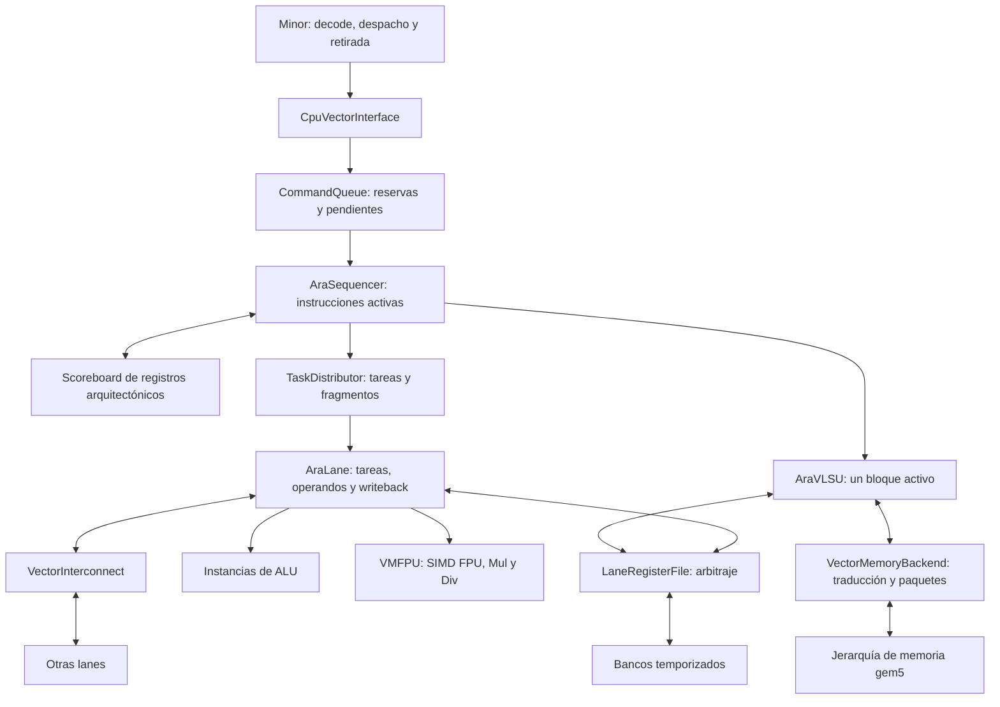

# Hito 2: concurrencia, VMFPU, anchos, interconexión y memoria por bloques

Estado: propuesta documental aprobada para su elaboración. No autoriza
implementar código ni crear pruebas. Fecha de referencia: 8 de octubre de
2026. Inspección del código en la revisión `f2c26f1ef2c3`.

Ampliación documental acordada el 9 de octubre de 2026: memoria unit-stride
por bloques, con un único bloque activo hasta completar memoria y VRF. Esta
ampliación tampoco autoriza implementar código ni crear pruebas.

Organización actual: [índice del hito 2](README.md) y
[baseline del hito 1](../hito1/README.md). La inspección histórica anterior
se conserva como contexto del diseño. El baseline ya dispone de benchmark
funcional y [estadísticas](<../hito1/Estadísticas.md>); esta actualización
no implementa concurrencia, VMFPU ni memoria por bloques.

## 1. Objetivo y relación con la primera etapa

El segundo hito convierte la VPU funcional Ara-like en un modelo con varias
instrucciones activas y recursos temporizados. Debe permitir estudiar cómo
las dependencias, las unidades funcionales, los bancos y la interconexión
limitan el progreso. La corrección arquitectónica sigue siendo obligatoria.

Los objetivos son:

- Solapar instrucciones aritméticas independientes, sin chaining.
- Incorporar una VMFPU por lane con SIMD FPU, SIMD Mul y SIMD Div.
- Eliminar la dependencia fija de elementos de 32 bits.
- Agrupar memoria unit-stride en bloques con buffers y accesos al VRF por
  palabra local, conservando una ejecución de memoria serializada.
- Parametrizar bancos, puertos, anchuras y número de ALUs por lane.
- Modelar colas finitas, arbitraje, latencias y contrapresión.
- Añadir una interconexión sencilla entre lanes.
- Establecer un procedimiento estable para incorporar instrucciones según
  las necesidades que revele el análisis de benchmarks.

La documentación puede prepararse mientras se termina Minor. La
implementación de este hito empezará después de cerrar la integración de la
primera etapa y validar su flujo funcional de extremo a extremo en modo SE.
La presencia de clases o cabeceras no acredita ese cierre.

Este documento amplía las decisiones del baseline únicamente en el alcance
descrito aquí. Las siguientes referencias conservan sus contratos para la
primera etapa:

- [Interfaces propuestas](<../hito1/Interfaces propuestas.md>): responsabilidades,
  identidad, tareas, VRF, memoria, propiedad de mensajes y drain.
- [Plan de integración](<../hito1/Cambios en gem5 v25 versión mejorada.md>): frontera
  con Minor y recorrido funcional de la primera etapa.

Las afirmaciones antiguas sobre módulos vacíos o anchos fijos se deben leer
en el contexto de aquella planificación. La sección siguiente identifica el
punto de partida observado para este nuevo hito.

## 2. Punto de partida observado

La revisión de código es una inspección de fuentes, no una certificación de
funcionamiento ni de integración con Minor.

| Componente | Situación observada |
| --- | --- |
| `AraSequencer` | Una única entrada `active`; libera la cabeza al cerrar. |
| `TaskDistributor` | Estado activo para una tarea y sus fragmentos. |
| `AraLane` | Un fragmento activo y slots de operandos y resultado. |
| `VectorRegBank` | Un acceso activo, compartido entre lectura y escritura. |
| `LaneRegisterFile` | Concesión por llegada; devuelve `Retry` al competir. |
| `AraVLSU` | Una tarea y un elemento en curso, incluido su acceso al VRF. |
| `VectorMemoryBackend` | Una petición lógica y un paquete físico en vuelo. |
| `VectorSupport` | Contempla elementos de 16 y 32 bits en el backend. |
| `Fpu` | Suma binary16 funcional con redondeo y flags explícitos. |
| Frontera CPU--VPU | No transporta aún contexto FP ni devuelve `fflags`. |
| `VectorInterconnect` | Los archivos `.hh` y `.cc` están vacíos. |

`ExecutionBundle` y `ExecutionResult` contienen patrones de bits en
`std::vector<uint32_t>`. Las máscaras y conversiones dependen de ese límite.
El mapper exige palabras múltiplo de cuatro bytes. Hay una base parcial para
generalizar anchos; ampliar una lista de SEW no resuelve todo el recorrido.

La demora mediante eventos de las unidades actuales asegura progreso
funcional. No debe utilizarse como latencia hardware validada de Ara.

## 3. Alcance, invariantes y exclusiones

Se mantienen estas decisiones:

- Minor decodifica. La VPU recibe `VectorCommand` con semántica y operandos
  resueltos, sin `StaticInst`, `DynInst` ni una segunda decodificación.
- `vsetvli` permanece en CPU. Cada comando conserva su configuración RVV.
- Admisión y comienzo de instrucciones en orden, con retirada en orden en
  Minor. La finalización de instrucciones independientes puede desordenarse.
- Referencias arquitectónicas mediante `VectorRegRef`.
- Identidad completa para comandos, tareas, fragmentos y accesos.
- Aceptar trabajo no equivale a ejecutarlo, entregarlo ni finalizarlo.
- Toda capacidad es finita y toda respuesta aceptada tiene un propietario.

La primera versión concurrente solapa aritmética previamente validada. La
memoria actúa como barrera y ejecuta una sola instrucción, por bloques en
orden. Sólo hay un bloque activo hasta cerrar sus efectos en memoria y VRF.
Los accesos al VRF de ese bloque pueden progresar en paralelo dentro de las
capacidades de bancos y puertos. El modelado sencillo de interconexión y una
candidata de slide se añaden sin activar chaining.

Quedan fuera de alcance:

- Renombramiento físico, RAT, free-list y ROB vectorial.
- Chaining, forwarding entre instrucciones y disponibilidad por elemento.
- Issue fuera de orden, bypass de la cabeza y ejecución especulativa.
- Solapamiento aritmética--memoria, varias instrucciones de memoria activas,
  varios bloques activos y varios paquetes físicos de memoria en vuelo.
- Memoria strided, indexed, segmentada o fault-only-first.
- Modelado de los canales AXI, soporte Full System y una MMU temporizada
  equivalente a la de Ara.
- Widening, narrowing, FMA, conversiones y raíces como operaciones activas.
- MASKU, SLDU completa, gathers y reducciones.
- Routers, flits, anillos, clusters y topologías de AraXL.
- Activación de lógica en `future/`, cobertura RVV completa y estimación PPA.

Reservar contratos de extensión no significa implementar esas funciones.
Cada ampliación posterior necesita su propuesta y aprobación de código.

## 4. Organización y responsabilidades



El diagrama describe responsabilidades, no el número de instancias C++.
La ruta de slide candidata deberá concretar su ejecutor antes de implementar
su conexión con sequencer, lanes e interconexión.

| Módulo | Responsabilidad en este hito |
| --- | --- |
| `VectorEngine` | Validar parámetros, construir y conectar; coordinar drain. |
| `CpuVectorInterface` | Identidad, validación de frontera y ciclo de vida. |
| `CommandQueue` | Reservas, orden de admisión y créditos globales. |
| `AraSequencer` | Iniciar en orden y agregar cierres por comando. |
| Scoreboard vectorial | Reservas de lectura/escritura y RAW, WAR, WAW. |
| `TaskDistributor` | Distribuir varias tareas sin perder sus identidades. |
| `AraLane` | Contextos, buffers, selección de FU y writeback local. |
| ALU y VMFPU | Cálculo y ocupación; sin acceso directo al VRF. |
| `LaneRegisterFile` | Mapear y arbitrar peticiones a sus bancos. |
| `VectorRegBank` | Aplicar accesos concedidos y devolver sus respuestas. |
| `VectorInterconnect` | Transporte con capacidad y latencia explícitas. |
| `AraVLSU` | Bloques, reunión de stores, reparto de cargas y cierre. |
| `VectorMemoryBackend` | Límites, traducción, paquetes, retry y faults. |

## 5. Anchos de elemento y geometría

### 5.1. Qué significa admitir anchos configurables

Se elimina el supuesto de que todo elemento tiene 32 bits. El primer perfil
admite SEW de 8, 16, 32 y 64 bits, las codificaciones estándar de RVV 1.0.
Los anchos superiores de SEW están reservados en esa especificación; otros
formatos exigirían declarar una extensión, no alterar silenciosamente RVV.

El conjunto de anchos se configura y se comprueba por operación y unidad.
No se promete que toda operación funcione en cualquier ancho declarado.
Por ejemplo, admitir enteros de 64 bits no habilita automáticamente FP64.

| Concepto | Significado |
| --- | --- |
| SEW | Ancho seleccionado para la instrucción. |
| EEW | Ancho efectivo de un operando concreto. |
| LMUL/EMUL | Grupo seleccionado y grupo efectivo por operando. |
| `lane_word_bytes` | Palabra física de banco y unidad del mapper. |
| Ancho de FU | Bytes procesados por bundle en una instancia. |
| VLEN | Capacidad arquitectónica de cada registro vectorial. |

Los contratos describirán EEW/EMUL por operando. La entrega inicial conserva
operaciones de igual ancho y memoria con EEW=SEW. Widening, narrowing y
memoria con EEW distinto podrán añadir sus reglas cuando se aprueben.

### 5.2. Representación y ejecución

El VRF y los mensajes de transporte conservan buffers de bytes. Los bundles
de ejecución deben transportar ancho, formato y operandos sin quedar
limitados por el contenedor actual `uint32_t`.

Los adaptadores funcionales interpretan esos bytes según la operación. Para
los enteros de hasta 64 bits se pueden usar contenedores `uint64_t`; eso es
una decisión local del cálculo, no el formato universal de transporte.

La capa común concentra:

- Número de bytes por elemento y tamaños comprobados de rangos.
- Máscaras y truncamiento al ancho activo, incluido el caso de 64 bits.
- Interpretación con signo y extensión del operando escalar desde XLEN.
- Conversión entre bytes y patrones de bits según el objetivo simulado.
- Reglas de división extrema sin comportamiento indefinido del host.
- Adaptadores FP que mantengan formatos, redondeo y flags explícitos.

No se sustituirán todos los campos `uint32_t` indiscriminadamente: índices,
identidades y tamaños pueden conservarlos si sus límites siguen siendo
válidos. Se revisarán especialmente los contenedores de valores y shifts.

### 5.3. Restricciones iniciales de mapeo

`AddressMapper` sigue siendo la única autoridad para lane, banco, fila y
posición de bytes. El layout físico permanece basado en bytes y palabras;
cambiar SEW no cambia el significado ni la ubicación de los bytes almacenados.
No se introduce el layout dependiente de SEW ni el reshuffle completo de Ara.

La primera geometría exige que:

- Los elementos admitidos quepan íntegramente en una palabra.
- Cada ancho de elemento habilitado divida `lane_word_bytes`.
- VLEN sea múltiplo de `lane_word_bytes * num_lanes`.
- Las capacidades y grupos se validen para la operación concreta.

Así, habilitar SEW=64 exige palabras de al menos ocho bytes. Reunir un
elemento repartido entre palabras o lanes queda fuera de la primera entrega.
Los LMUL que no alojan un elemento de cierto ancho no tienen por qué excluir
otros anchos; admisión valida la combinación, sin usar un mínimo fijo de 32.

Una palabra de 16 bytes aloja cuatro enteros de 32 bits u ocho de 16. El
distribuidor la divide en bundles según ancho y capacidad de las FUs. El
número de elementos del vector no se confunde con el ancho SIMD del recurso.

## 6. Concurrencia, dependencias y créditos

### 6.1. Estados y capacidad

Se diferencian reserva, aceptación, inicio, finalización y retirada. Una
orden aceptada puede esperar en la FIFO; una activa tiene contexto de
ejecución; una terminada puede seguir retenida en Minor hasta su retirada.

El control de admisión conserva un crédito por comando hasta entregar su
finalización. Mover una orden al estado activo no devuelve ese crédito.

```text
reservas + aceptadas pendientes + activas/cerrando <= command_queue_entries
activas ejecutando <= max_active_commands
```

Los estados son excluyentes para contar cada comando una sola vez. Una orden
cerrando ya no ejecuta, pero conserva crédito hasta completar la notificación.
Minor mantiene además su propio límite de entradas hasta la retirada.

El sequencer inicia desde la cabeza de pendientes. Si faltan dependencias,
contextos o capacidad de destino, esa cabeza espera y no hay bypass. El
trabajo ya iniciado continúa. Antes de iniciar se reservan su contexto y las
obligaciones necesarias para repartirlo sin duplicar tareas ante `Retry`.

Un rango vacío no genera accesos ni paquetes. Su cierre único sigue las
reglas de identidad, créditos y retirada.

### 6.2. Scoreboard arquitectónico conservador

La propuesta introduce un scoreboard activo para este hito, separado de la
tabla granular reservada en `future/`. Registra, por comando, los grupos
leídos y escritos. No asigna registros físicos ni versiones.

- RAW: una fuente espera a todos los writebacks del productor anterior.
- WAR: una escritura espera al cierre del lector anterior del grupo.
- WAW: un escritor espera al cierre del escritor anterior del grupo.
- Lecturas concurrentes del mismo grupo sí pueden coexistir.

Se reservan registros arquitectónicos completos del grupo efectivo. Para
LMUL fraccional se reserva conservadoramente el registro contenedor. Los
grupos parcialmente coincidentes también producen conflicto.

La reserva se realiza al iniciar, comparando sólo con comandos anteriores.
Las lecturas y escrituras de una misma instrucción no se bloquean a sí mismas;
la unidad aplica su orden interno y las reglas legales de solapamiento.
Todas las reservas del comando se liberan después de cerrar tareas y
writebacks. Esto limita el paralelismo, pero evita readiness parcial.

Ejemplo: una multiplicación sobre `v1` y una suma que escribe `v8`, con fuentes
independientes, pueden solaparse. Una suma que consume `v1` espera al cierre
completo de la multiplicación, aunque algunas lanes ya hayan escrito.

## 7. Despacho y retirada en Minor

Ampliar únicamente las colas de la VPU no basta. El despacho desde una sola
cabeza de commit que espera `completed` serializaría toda la ejecución.

La primera integración concurrente separa el cursor de despacho vectorial
de la cabeza de retirada, aprovechando las entradas en vuelo de Minor. Se
propone una ventana acotada de aritmética vectorial consecutiva:

1. Antes de abrirla, todas las instrucciones anteriores han terminado y los
   caminos de control que podrían anularla están resueltos.
2. Se validan legalidad, soporte y operandos de cada instrucción antes de
   solicitar su reserva y despacharla en orden.
3. Cada instrucción conserva `MinorVectorState` y su `CommandKey` hasta
   procesar la finalización y retirarse.
4. El callback guarda la respuesta en su entrada, aunque no sea la cabeza.
5. Sólo la retirada aplica resultados escalares, estado RVV y flags FP en
   orden. No se ejecuta otra vez la instrucción por su ruta nativa.

La ventana inicial no atraviesa instrucciones escalares, cambios de
configuración, CSRs, control, operaciones no soportadas ni memoria. Si una
instrucción joven se rechaza, se detiene el despacho; las anteriores terminan
antes de procesar la excepción local. No se entregan órdenes posteriores.

El solapamiento inicial requiere `vstart=0`. Las instrucciones que necesitan
reinicio con `vstart` no nulo se ejecutan aisladas. Los snapshots de `vl`,
`vtype`, operandos escalares y redondeo no se recapturan tras `Stall`.

### 7.1. Memoria como barrera

Una carga o store vectorial empieza después de retirar las instrucciones
anteriores y cerrar los accesos escalares pendientes relevantes de la LSQ.
Impide despachar trabajo posterior hasta procesar su éxito o fault.

La VLSU sustituye la petición por elemento del baseline por bloques de
elementos contiguos, según la sección 7.3. Mantiene un único bloque activo y
no inicia el siguiente hasta completar sus efectos en memoria y VRF. Se
conservan la respuesta terminal única, el retry timing y la comunicación de
faults a Minor mediante `finalVstart`. Los accesos que no puedan agruparse
con seguridad conservan el recorrido por elemento.

La retirada ordenada no protege por sí sola el VRF: si una instrucción joven
ya escribió, un fault anterior necesitaría recuperación. La barrera evita
ese caso sin añadir rollback o almacenamiento especulativo de resultados.

### 7.2. Flags, interrupciones y drain

El contexto FP se captura en CPU. Los flags se agregan por fragmento, tarea
y comando, y se devuelven a Minor para acumularlos al retirar. No se modifican
CSRs desde callbacks de lanes ni se aplica antes de tiempo el `vstart` de una
instrucción joven. Los accesos a `frm`, `fflags` y `fcsr` cierran la ventana.

Las interrupciones y el descarte deben respetar un punto arquitectónico
seguro: no se anula trabajo ya admitido sin un contrato de recuperación.
La propuesta de código detallará su coordinación con los caminos de Minor.

Drain cierra grants nuevos y deja terminar reservas concedidas, comandos,
fragmentos, lecturas, pipelines, transferencias, writebacks y callbacks.
También exige que Minor procese las finalizaciones retenidas. Ninguna cola
vacía por sí sola demuestra que el sistema esté drenado.

### 7.3. Memoria unit-stride por bloques

La unidad de trabajo interna de la VLSU pasa de un elemento a un rango de
elementos contiguos. `VectorCommand` y `MemoryTask` siguen describiendo la
instrucción completa; el cambio se concentra en la VLSU, sus mensajes de
memoria y el backend. La agrupación conserva EEW=SEW y el soporte de anchos
de la sección 5. No incorpora máscaras de predicación ni nuevos modos de
direccionamiento.

El alcance elegido mantiene una instrucción de memoria, un bloque activo y
un paquete físico en vuelo como máximo. Las colas y buffers tienen capacidad
finita. Preparar metadatos no permite iniciar accesos del siguiente bloque
antes de cerrar el actual. No hay una ventana de cargas pendientes ni
solapamiento con aritmética.

#### 7.3.1. Formación y límites del bloque

El generador de la VLSU parte del siguiente índice absoluto `i`, del tamaño
de elemento `E` y de la base capturada en el comando. La dirección inicial
es `base + i * E`, con el ancho de dirección del objetivo. El rango de VRF
empieza en `i * E`; `vstart` no desplaza la base del vector.

El backend proporciona los tamaños de página y línea como valores del
contexto, sin exponer `ThreadContext`, MMU ni objetos de gem5 a la VLSU. La
configuración fija `memory_max_block_bytes`, cuyo nombre es propuesto. El
bloque se recorta al menor límite y contiene elementos completos:

```text
M = min(bytes restantes, máximo de bloque,
        bytes hasta fin de línea, bytes hasta fin de página,
        bytes hasta fin del espacio de direcciones del objetivo)
elementCount = floor(M / E)
blockBytes = elementCount * E
```

Se comprueban productos, sumas y rangos sin overflow. No se accede a bytes
anteriores a `vstart` ni posteriores a `vl` para rellenar una línea. Un rango
vacío no crea bloques. El bloque final puede ser menor que el máximo.

Si un elemento cruza una frontera y no cabe íntegro, se usa una petición de
un elemento con la fragmentación física del baseline. Después se continúa
agrupando. La traducción verifica también que cada paquete físico respete
su línea. Un bloque puede cubrir varias palabras y lanes del VRF, manteniendo
la restricción de que cada elemento cabe en una palabra local.

Ejemplo con `vl=20`, `vstart=0`, elementos de cuatro bytes, base `0x1000`,
líneas de 64 bytes y máximo de bloque de 64 bytes:

| Bloque | Elementos | Dirección virtual | Bytes |
| --- | --- | --- | --- |
| 0 | 0--15 | `0x1000` | 64 |
| 1 | 16--19 | `0x1040` | 16 |

El camino agrupado requiere dos peticiones frente a las veinte de cuatro
bytes del baseline. Con base `0x1030`, los límites serían un bloque inicial
de 16 bytes y otro de 64. El tamaño de bloque no representa el ancho físico
del bus ni una ráfaga AXI; la jerarquía configurada en gem5 modela el
transporte del paquete.

#### 7.3.2. Mensajes e identidad

El descriptor lógico de memoria distingue tamaño de elemento y tamaño de
bloque. La propuesta de código concretará su representación en
`common/memory_types.hh` y actualizará los validadores y `LoadData`.

| Campo o relación | Contrato propuesto |
| --- | --- |
| `TaskKey`, `requestId` | Identidad del bloque, estable ante retry. |
| Dirección y operación | Dirección virtual inicial y carga/store. |
| `elementBytes` | Tamaño de cada elemento en bytes. |
| `firstElement`, `elementCount` | Rango absoluto de elementos. |
| `size`, `dataRange` | Tamaño del bloque y rango de bytes del VRF. |
| Registro y datos | Referencia arquitectónica y bytes del store. |
| Metadatos CPU | Contexto, PC y `requestorId` originales. |
| Accesos al VRF | `accessId` propio, asociado al bloque y offset de bytes. |

Se exige `size = elementCount * elementBytes` y un `dataRange` con tamaño
`size` y offset `firstElement * elementBytes`. El buffer del store contiene
`size` bytes; en cargas está vacío.

Una petición de bloque no tiene una única `laneId`: sus destinos o fuentes
proceden de `AddressMapper`. Los fragmentos físicos de memoria conservan la
clave del bloque y una correlación privada del backend. Los accesos locales
al VRF tienen identidades distintas de esos fragmentos.

El backend devuelve una sola respuesta terminal por bloque aceptado:
`LoadData` con todos sus bytes, `StoreAck` o `Fault`. La VLSU valida clave,
tamaño y fase antes de consumirla. Los mensajes y buffers aceptados tienen
propiedad definida y sobreviven a todos sus callbacks.

#### 7.3.3. Cargas y reparto al VRF

La VLSU reserva el buffer del bloque antes de enviarlo. El backend traduce y
envía sus paquetes; en el camino agrupado habitual hay un paquete por bloque.
En el camino por elemento fragmentado se traducen los fragmentos antes del
primer envío y se sirven de uno en uno, como en el baseline.

Al recibir todos los bytes de una carga correcta, la VLSU consulta
`AddressMapper` y crea accesos de escritura por palabra local. Cada uno
conserva clave, rango, lane y posición dentro del buffer. No se envía un
acceso de todo el bloque a un LRF, cuya frontera sigue siendo una palabra.

Los accesos a bancos distintos pueden progresar en paralelo según la
capacidad disponible. Un `Retry` conserva sólo el acceso no aceptado; uno
ya aceptado no se vuelve a emitir. La VLSU mantiene los datos y las
asociaciones hasta recibir todos los `WriteAck`. El bloque sólo entonces
termina y el siguiente índice avanza en `elementCount`.

Con cuatro lanes, palabras de ocho bytes y un rango VRF alineado de 64
bytes, un bloque de dieciséis elementos de 32 bits necesita ocho accesos
locales en lugar de dieciséis. Un rango parcial conserva los bytes exteriores
mediante los byte enables. El endianness no depende del host.

#### 7.3.4. Stores y reunión de datos

La VLSU mapea el rango del bloque y reserva su buffer antes de pedir lecturas
al VRF. Cada respuesta se copia al offset asociado a su `accessId`; el orden
de llegada no determina la posición de los bytes. Los datos deben cubrir el
rango exactamente una vez, sin huecos ni duplicados.

Sólo después de recibir todas las lecturas se envía el bloque al backend.
El buffer capturado permanece estable ante retry: no se releen los registros
ni se reconstruyen los datos. Se espera a `StoreAck`, con todos los paquetes
cerrados, antes de preparar accesos del siguiente bloque.

#### 7.3.5. Contrapresión, faults y drain

Se conservan los dos niveles de retry. Si el backend rechaza la petición
lógica, la VLSU mantiene el mismo descriptor y buffer. Una vez aceptada, el
backend gestiona sus paquetes; tras un `sendTimingReq` fallido conserva el
mismo paquete y espera `recvReqRetry`. Un paquete aceptado espera respuesta
y nunca se reenvía por tardar. La recepción se reserva antes de emitir.

El estado mantiene contadores o conjuntos de accesos pendientes. Un bloque
no termina por recibir una única confirmación ni por vaciar una cola de
envío: deben quedar cerrados memoria, lecturas y escrituras del VRF.

La agrupación no garantiza atomicidad de stores ni localización de un byte
fallido a partir de cualquier error del puerto. La propuesta de código debe
definir la RAM agrupable, las garantías de sus respuestas y la asociación
entre dirección de fault, elemento y `finalVstart`. Si no se puede preservar
ese contrato, el acceso usa el recorrido por elemento desde el principio.
No se reenvía un store fallido para intentar localizar la causa.

Al fallar la traducción de una página que contiene todo un bloque, el índice
causante es su primer elemento activo y no se envía ese bloque. Por ejemplo,
con base `0x1FF0`, ocho elementos de cuatro bytes y páginas de 4096 bytes, el
primer bloque completa los elementos 0--3. Si la página de `0x2000` falla,
se comunica `finalVstart=4` sin iniciar elementos posteriores. Para errores
de acceso no se inventa un índice fino que la respuesta no proporciona.

Los bloques anteriores permanecen completados. Una carga fallida no escribe
sus datos al VRF. Antes de comunicar `MemoryFault` se cierran todos los
callbacks y accesos aceptados. Minor procesa la excepción según su contrato;
la VLSU no aplica por su cuenta el estado arquitectónico de la CPU.

Drain cierra la admisión y deja terminar el bloque y el trabajo del comando
ya aceptado. Conserva buffers, traducciones, paquetes, accesos al VRF y
finalizaciones hasta su cierre. No cancela trabajo ni descarta faults.

#### 7.3.6. Beneficios y límites del modelo

Se espera reducir las peticiones pequeñas, las llamadas de traducción y los
accesos al VRF por elemento, y aprovechar palabras, bancos y lanes para
transferir varios elementos. Los buffers permiten retener datos ante
contrapresión y observar por separado las esperas de memoria y del VRF.

La reducción de paquetes no promete una aceleración proporcional ni la misma
reducción de tráfico DRAM: las cachés ya rellenan líneas en sus misses. Una
sola petición de memoria en curso sigue limitando cuánto se puede ocultar
su latencia. Los resultados deben explicarse con bytes, paquetes, accesos y
tiempos de espera del modelo.

El flujo se aproxima a la separación de generación, transferencia y VRF de
Ara. Se conserva el layout por bytes del proyecto y el protocolo timing de
gem5. En RISC-V SE la traducción actual usa la tabla de páginas del proceso;
`translateTiming` no acredita latencias de DTLB o page walks de Ara. La
topología debe concretar el camino vectorial, sus cachés compartidas y la
visibilidad de datos respecto al tráfico escalar.

La entrega se organiza en subentregas revisables descritas en la sección 13.

## 8. Lanes, colas y VMFPU

### 8.1. Progreso local y propiedad de buffers

Cada lane conserva varios contextos de fragmento. Un contexto identifica
tarea, operandos, fase, FU asignada, resultado y accesos pendientes. Los
operandos se reúnen por identidad y papel, nunca por orden de respuesta.

Las colas finitas se sitúan en el camino de ejecución:

```text
contextos de tareas -> peticiones VRF -> colas de operandos
                                      -> ALUs / VMFPU
                                      -> colas de resultados -> writeback
```

Una fuente escalar capturada no necesita lectura del VRF. Antes de conceder
una lectura se reserva capacidad para su retorno; antes de iniciar cálculo
se reserva capacidad para su resultado. La reserva puede pertenecer a una
entrada de pipeline o a una cola, pero sólo se cuenta una vez.

Cada FU tiene sus colas o créditos de resultado. Una división pendiente no
ocupa el único slot global de todos los cálculos. El arbitraje de writeback
permite que otros resultados progresen cuando sus bancos estén disponibles.

El distribuidor admite varias tareas y agrega fragmentos por `TaskKey`. El
sequencer agrega tareas por `CommandKey`. Un `WriteAck` cierra el writeback
correspondiente, no todas las escrituras del comando.

### 8.2. Organización de la VMFPU

Se incorpora una VMFPU por lane como coordinador de tres componentes. La
ALU entera continúa como recurso independiente.

| Componente | Operaciones iniciales propuestas | Modelo |
| --- | --- | --- |
| SIMD FPU | Suma, multiplicación y división FP32 | Segmentado/multiciclo |
| SIMD Mul | Multiplicación entera, resultado bajo | Segmentado |
| SIMD Div | División y resto enteros | Multiciclo |

La VMFPU recibe bundles semánticos, selecciona la subunidad y retorna
resultados con la identidad original. No decodifica opcodes, accede al VRF
ni decide dependencias globales.

La suma binary16 actual se conserva como capacidad interna. Declarar soporte
arquitectónico FP16 desde CPU exige comprobar la extensión y completar ese
recorrido; no se deduce de disponer del cálculo funcional.

Cada subunidad declara por operación y ancho:

- Latencia del resultado, en ciclos del reloj de la VPU.
- Intervalo de iniciación entre bundles.
- Anchura SIMD y máximo de operaciones pendientes.
- Capacidad de entrada y de resultados, con unidad explícita.

Un perfil con latencia 4 e intervalo 1 puede admitir un bundle cada ciclo.
Una unidad multiciclo no segmentada permanece ocupada hasta cerrar su
operación. Los perfiles iniciales son parámetros del modelo, no latencias
hardware verificadas de Ara. El divisor puede empezar con latencia fija por
ancho; un algoritmo de latencia dependiente de datos requerirá otro perfil.

La actividad se programa mediante eventos de gem5, sin esperas del host. La
contrapresión puede detener una subunidad al agotar resultados, pero no
congela automáticamente las otras FUs. El inicio global sigue siendo FIFO:
la independencia local no habilita bypass de instrucciones.

### 8.3. Varias ALUs

`alus_per_lane` crea instancias independientes, cada una con ocupación e
identidad de ejecución. La lane asigna bundles elegibles a instancias libres
con política determinista. La división de palabras y fragmentos mantiene
la cobertura exacta de elementos y evita escrituras duplicadas.

Se distingue procesar varios elementos SIMD en una ALU ancha de ejecutar
varios bundles en varias ALUs. Aumentar uno de esos recursos no crea
operandos ni puertos adicionales. La mejora queda limitada por lectura,
writeback, dependencias y capacidad del distribuidor.

## 9. Bancos, puertos y arbitraje

### 9.1. Capacidad física

Se mantiene inicialmente la igualdad entre palabra física del banco y
`lane_word_bytes`. La anchura de cada FU y su número de instancias son
parámetros independientes, compatibles con las restricciones de elementos.

Los bancos admiten puertos dedicados de lectura R, escritura W y compartidos
RW. Cada RW sirve una lectura o una escritura por oportunidad de acceso.

| Perfil | Lecturas/escrituras que puede conceder por oportunidad |
| --- | --- |
| 1RW | Una lectura o una escritura. |
| 1R1W | Una lectura y una escritura compatibles. |
| 2R1W | Hasta dos lecturas y una escritura compatibles. |

Latencia e intervalo de acceso se separan. Un banco segmentado puede admitir
otro acceso antes de responder al anterior si tiene puerto y espacio de
retorno. Un banco no segmentado conserva su ocupación durante la operación.

Como regla inicial, una lectura y una escritura de la misma fila se
serializan hasta cerrar la escritura; también se serializan escrituras con
bytes habilitados coincidentes. No se deja ese comportamiento al orden de
los callbacks. Lecturas compatibles y accesos a otras filas pueden coexistir.

### 9.2. Arbitraje del LRF

El LRF recoge solicitudes persistentes de los emisores y evalúa las
concesiones conjuntamente en el ciclo. Se propone round-robin por banco y
clase de puerto compatible. Las solicitudes de writeback participan con
progreso garantizado; no existe prioridad permanente de lecturas.

Los emisores conservan la petición hasta su concesión. El banco no añade
una FIFO de solicitudes denegadas. El estado del LRF para arbitrar y retornar
accesos concedidos no duplica las colas de operandos o resultados.

La implementación deberá separar registrar una solicitud de concederla si
la API inmediata actual no permite comparar todos los candidatos del ciclo.
Un mensaje aceptado sigue obligando a una única respuesta. El contrato de
frontera y propiedad se concretará en la propuesta de código de esta entrega.

La política no debe depender del orden en que se recorren las lanes o se
invocan callbacks. Tampoco se concede una lectura si no hay espacio reservado
para recibirla. Más puertos no eliminan incompatibilidades ni contrapresión.

### 9.3. Parámetros y validación

Los nombres siguientes son propuestos; los ya existentes conservan su
significado cuando sea compatible. La configuración pertenece a
`VectorEngine` y permanece inmutable durante la simulación.

| Parámetro/familia | Unidad y significado |
| --- | --- |
| `supported_sews` | Conjunto de anchos de elemento, en bits. |
| `command_queue_entries` | Comandos, incluidas reservas y activos/cerrando. |
| `max_active_commands` | Instrucciones ejecutando en la VPU. |
| `minor_vector_window_entries` | Instrucciones retenidas hasta retirada. |
| `lane_task_entries` | Contextos de fragmento aceptados por lane. |
| Buffers de operandos/resultados | Entradas de bundle, por fuente/FU. |
| `memory_max_block_bytes` | Máximo de bytes por bloque de memoria. |
| `lane_word_bytes`, `banks_per_lane` | Anchura de banco y bancos por lane. |
| Puertos R/W/RW por banco | Accesos por oportunidad, según tipo. |
| Latencias/intervalos de banco | Ciclos hasta respuesta y entre accesos. |
| `alus_per_lane` | Instancias de ALU por lane. |
| Anchuras/latencias/intervalos de FU | Bytes por bundle y ciclos. |
| Capacidades de FU | Operaciones pendientes por subunidad. |
| Latencia de interconexión | Ciclos de tránsito, sin espera ni servicio. |
| Ancho de banda de interconexión | Bytes por ciclo de origen y destino. |
| Buffers de interconexión | Paquetes y bytes reservados por destino. |

Se validan capacidades positivas, productos sin overflow, formatos
implementados y coherencia con el estado arquitectónico de Minor. Se exige
`max_active_commands <= command_queue_entries`. La ventana CPU puede limitar
el paralelismo efectivo aunque la VPU tenga más entradas.

El máximo de bloque es positivo, aloja al menos un elemento de cada ancho
de memoria habilitado y es divisible por esos tamaños. La entrega mantiene
un único bloque activo y buffers acotados por ese máximo; configurar más
capacidad no habilita varias peticiones de memoria en vuelo. Los bloques
efectivos se recortan según la sección 7.3.1.

Un buffer de bundle declara también su máximo de bytes. No se confunden
entradas de cola con elementos, palabras, paquetes o bytes. Una geometría
inválida falla antes de ejecutar; una operación no soportada se rechaza antes
de reservar; la falta temporal de capacidad produce contrapresión.

## 10. Interconexión sencilla entre lanes

### 10.1. Modelo inicial

Se propone un crossbar lógico con conectividad entre cualquier par de lanes,
contención por destino y límite de inyección por origen. No es una NoC de
routers y flits ni una reproducción física exacta de Ara.

Cada destino concede servicio mediante round-robin entre orígenes elegibles.
Distintos destinos pueden transferir en paralelo si no superan la capacidad
de sus orígenes. Los límites se aplican a datos reales, no multiplicando una
latencia por el número de lanes.

Para un paquete de `n` bytes y ancho de banda `b` bytes/ciclo, el servicio
ocupa `ceil(n / b)` ciclos. La entrega sucede después del servicio y de la
latencia de tránsito configurada. Se empieza con servicio de un paquete
cada vez por destino, sin entregar fragmentos parciales al receptor.

La aceptación reserva buffers finitos y capacidad en el receptor. Un paquete
que no cabe devuelve `Retry` sin efectos. Los paquetes deben respetar el
máximo de bytes configurado; su productor divide un movimiento mayor en
paquetes identificados. El transporte no introduce flits.

### 10.2. Identidad y contrato de entrega

```text
TransferKey = (TaskKey, transferId)
InterconnectPacket = {
    key, sourceLane, destinationLane, kind,
    sourceRange, destinationReg, destinationRange,
    data, byteEnable
}
```

El propietario de la tarea asigna `transferId` único dentro de `TaskKey`,
también si intervienen varias lanes origen. Los rangos son lógicos y el
mapper resuelve los accesos físicos. Las longitudes de datos y máscara deben
coincidir con el rango transportado.

El productor prepara el paquete después de obtener los datos de origen.
`kind` describe su uso semántico; no contiene un opcode ni ordena a la red
ejecutar una instrucción. No se habilita `operand_forward` entre comandos.

Se distinguen tres acontecimientos:

1. Aceptación: la red posee una copia y las reservas necesarias.
2. Entrega: el receptor posee los datos; el crédito de transporte se libera
   cuando consume el paquete en su capacidad reservada.
3. `WriteAck`: el destino del VRF ya recibió la escritura correspondiente.

La tarea conserva las asociaciones hasta cerrar los accesos. Cada paquete
aceptado tiene una entrega única; `Retry` conserva clave y contenido. Una
marca de último paquete no sustituye contar transferencias pendientes y
comprobar la cobertura del rango. Drain incluye paquetes en cola y tránsito.

### 10.3. Primera candidata funcional

`vslide1up.vx` es una candidata para ejercitar datos que cruzan lanes y la
inyección de un escalar. No se declara seleccionada ni implementada.

Si el equipo la selecciona, la propuesta de código definirá un ejecutor
mínimo de slide que:

- Identifique fuentes y destinos mediante `AddressMapper`.
- Resuelva la semántica del primer elemento y del rango activo.
- Valide las restricciones de grupos y solapamiento de RVV.
- Obtenga los datos antes de las escrituras que puedan destruirlos.
- Transporte fragmentos remotos y utilice el LRF para los writebacks.
- Devuelva `UnitCompletion` después de todos los `WriteAck`.

El ejecutor pertenece a la ruta de datos activa que se proponga, no a
`future/`. No requiere implementar SLDU completa. Si se elige otra operación,
deberá ofrecer un recorrido entre lanes equivalente y una propuesta aprobada.
La existencia de un transporte sin ningún productor funcional no acredita
el objetivo de interconexión del hito.

## 11. Extensibilidad del conjunto de instrucciones

### 11.1. Descripción semántica y autoridad de soporte

`VectorSupport` será la autoridad compartida para comprobar capacidades.
Se ampliará con descripciones semánticas, por ejemplo `OperationTraits`,
sin copiar listas independientes en frontend, lanes y admisión.

| Metadato de operación | Consumidor y finalidad |
| --- | --- |
| Fuentes/destinos y roles | CPU, tareas y scoreboard. |
| Anchos y formatos admitidos | Admisión y adaptadores funcionales. |
| EEW/EMUL por operando | Grupos, rangos y restricciones de solapamiento. |
| Clase de ejecución | Selección de ALU, FPU, Mul, Div o unidad global. |
| Contexto requerido | Captura de redondeo y estado en CPU. |
| Efectos y faults posibles | Barreras y tratamiento arquitectónico. |
| Perfil temporal por ancho | Recursos y calendario de la unidad. |

Una operación semántica puede representar varias formas de instrucción.
Por ejemplo, la suma comparte cálculo entre fuentes vectoriales y escalares;
la CPU normaliza la forma antes de entregar el comando. La descripción no
extrae bits de instrucciones ni reemplaza la decodificación de gem5.

Los contratos documentarán fuentes adicionales y lectura del destino para
operaciones destructivas. La propuesta de código decidirá si se requieren
operandos tipados adicionales o una colección tipada, manteniendo validación
estructural. No se asume para toda operación que hay exactamente dos fuentes
con igual EEW ni se implementa FMA para preparar esa extensión.

### 11.2. Procedimiento para añadir una operación

1. Identificar benchmark, forma y ancho requeridos, y consultar su semántica.
2. Definir operandos, grupos, efectos, unidad y capacidades.
3. Presentar la propuesta de código, incluidos archivos y validación sugerida.
4. Tras aprobarla, añadir la traducción semántica en CPU.
5. Registrar soporte y añadir el adaptador de cálculo y su perfil temporal.
6. Reutilizar tareas, dependencias, transporte y cierres de su familia.
7. Actualizar la matriz de soporte y documentar comprobaciones realizadas.

Para una operación de una familia existente no debería ser necesario cambiar
el arbitraje, el control de créditos ni el algoritmo del sequencer. Una nueva
familia, como reducciones, puede necesitar módulos y contratos adicionales.
La extensibilidad no implica que cualquier opcode se añada sólo con una fila.

### 11.3. Matriz funcional propuesta

Todas las filas son objetivos o candidatos; no son afirmaciones de soporte
actual. El subconjunto aprobado para implementar se concretará por entrega.

| Familia | Formas propuestas | Anchos iniciales |
| --- | --- | --- |
| `vadd` | `.vv`, `.vx` | Enteros 8/16/32/64 |
| `vle` / `vse` unit-stride | EEW igual a SEW | 8/16/32/64 |
| `vmul` | `.vv`, `.vx`, mitad baja | Enteros de 32 bits |
| `vdiv`, `vdivu` | `.vv`, `.vx` | Enteros de 32 bits |
| `vrem`, `vremu` | `.vv`, `.vx` | Enteros de 32 bits |
| `vfadd`, `vfmul`, `vfdiv` | `.vv` | FP32 |
| `FloatAdd` interno existente | Dos fuentes vectoriales | Binary16 |
| `vslide1up.vx` candidata | Pendiente de selección | Por concretar |

La infraestructura admite una matriz mayor sin rehacer los mensajes. Ampliar
Mul/Div a otros anchos, FP64 o formas `.vf` son siguientes entradas de esa
matriz, pendientes de selección y aprobación. La ruta FP exige capturar el
contexto y devolver flags hasta CPU antes de anunciar soporte arquitectónico.

## 12. Selección de próximas instrucciones con benchmarks

El análisis de benchmarks se prepara documentalmente; no se ejecuta ni se
añaden scripts o pruebas en esta entrega. Se propone registrar:

| Campo | Utilidad para priorizar |
| --- | --- |
| Benchmark y ROI | Separar kernel de inicialización y biblioteca. |
| Instrucción y forma | Identificar la operación realmente necesaria. |
| Frecuencia dinámica | Cuántas veces se ejecuta en la ROI. |
| SEW, EEW y LMUL/EMUL | Elegir las combinaciones que hay que soportar. |
| Máscaras y addressing | Detectar dependencias de familias aún ausentes. |
| Estado de soporte | Completo, parcial o ausente en CPU/backend. |
| Coste y recurso dominante | Cómputo, memoria, VRF, red o dependencias. |
| Trabajo requerido | Adaptador, extensión de familia o nuevo módulo. |
| Prioridad acordada | Beneficio esperado y coste de implementación. |

Una instrucción poco frecuente puede desbloquear un benchmark completo.
Frecuencia y porcentaje de tiempo tampoco son equivalentes. La selección
combina necesidad funcional, impacto, reutilización y esfuerzo.

Para cada siguiente operación se preparará una ficha con fuente semántica,
operandos, anchos, unidad, temporalización, efectos, archivos previstos y
recorrido de validación sugerido. Esta ficha forma parte del procedimiento
de propuesta y aprobación, no de un mecanismo de registro de plugins.

## 13. Entregas y dependencias

Las entregas ordenan el trabajo; no son autorizaciones de implementación.
Cada una debe producir un cambio pequeño, revisable y con comprobaciones
acordadas. No se declara terminado el hito con concurrencia sólo interna.

| Entrega | Resultado esperado |
| --- | --- |
| 0. Baseline | Minor, faults, drain y flujo SE de la primera etapa cerrados. |
| 1. Contratos | Anchos, metadatos, capacidades y estados definidos. |
| 2. Anchos | Suma y memoria unit-stride de 8/16/32/64 bits. |
| 3. Recursos | Colas finitas, bancos temporizados y arbitraje. |
| 4. Memoria por bloques | Unit-stride, buffers y VRF; un bloque activo. |
| 5. Concurrencia | Scoreboard y ventana Minor, con retirada ordenada. |
| 6. VMFPU y ALUs | Subunidades independientes y varias ALUs por lane. |
| 7. Interconexión | Crossbar sencillo y operación entre lanes seleccionada. |
| 8. Extensión | Matriz de soporte y procedimiento para nuevas operaciones. |

La entrega 1 define los contratos utilizados por las demás. La entrega 2
elimina los supuestos de 32 bits antes de añadir caminos de cálculo. La
entrega 3 proporciona capacidad y arbitraje para los accesos de bloques y
para la concurrencia. La entrega 4 sustituye el recorrido por elemento sólo
en los casos agrupables y conserva el contrato arquitectónico con Minor.
La VMFPU y la red utilizan los mismos contratos de buffers e identidad.

La entrega 5 puede dividirse en control interno y despacho CPU, pero ambos
son necesarios para demostrar solapamiento de instrucciones del programa.
La matriz y las fichas de la entrega 8 se mantendrán desde el principio,
aunque su uso con benchmarks sea posterior.

### 13.1. Subentregas de memoria por bloques

1. **Contrato de bloques y faults:** mensajes, límites, identidades,
   memoria agrupable y recorrido por elemento para casos especiales.
2. **Generación:** formación de bloques por rango, línea y página; manejo
   de `vstart`, tail, desalineación y ancho de dirección.
3. **Backend:** admisión de rangos, traducción, paquetes y respuesta terminal,
   con un único paquete físico en vuelo y retry conservado.
4. **Datos y VRF:** buffers de carga/store, reparto de escrituras y reunión
   de lecturas por palabra; cierre de cada acceso por identidad.
5. **Integración y observabilidad:** camino de memoria compartido con Minor,
   estadísticas, faults y drain; validación acordada con el equipo.

Cada subentrega debe demostrar cobertura exacta de bytes, ausencia de
duplicados, conservación de datos ante `Retry` y cierre de las obligaciones
aceptadas que introduce. La implementación se revisa por esos resultados;
generar código no acredita por sí solo la corrección del recorrido.

## 14. Archivos previstos para futuras propuestas de código

Los nombres nuevos siguientes son destinos propuestos para implementar
este diseño en entregas futuras. La reorganización documental y las
estadísticas del hito 1 no implementan los recursos propuestos aquí.

### Configuración y contratos compartidos

- `src/cpu/vector_engine/VectorEngine.py` y `vector_engine.hh/.cc`:
  parámetros, construcción de recursos y coordinación de drain.
- `src/cpu/vector_engine/common/vpu_parameters.hh`, `vrf_types.hh`,
  `vector_types.hh`, `execution_types.hh` y `fp_types.hh`: capacidades,
  formatos y mensajes, sin duplicar configuración arquitectónica.
- `src/cpu/vector_engine/common/memory_types.hh`: descriptores por bloque,
  rangos de elementos, datos de carga y asociaciones con accesos al VRF.
- `src/cpu/vector_engine/common/vector_support.hh/.cc`: soporte por
  operación/ancho y adaptadores comunes de datos.
- `src/cpu/vector_engine/common/backend_task.hh`, `lane_task.hh`,
  `lane_completion.hh` y `unit_completion.hh`: operandos y agregación.
- `src/cpu/vector_engine/interface/vector_command.hh`,
  `vector_completion.hh` y `cpu_vector_interface.hh/.cc`: contexto FP,
  flags y comprobaciones de frontera.
- Posible `common/operation_traits.hh`: descripción semántica si conviene
  separarla de `VectorSupport`; sin imponer un archivo por instrucción.

### Frontend e integración CPU

- `src/cpu/vector_engine/frontend/command_queue.hh/.cc`,
  `ara_sequencer.hh/.cc` y `task_distributor.hh/.cc`: múltiples contextos,
  créditos conservados y correlación de respuestas.
- Nuevo `src/cpu/vector_engine/frontend/vector_scoreboard.hh/.cc`:
  reservas arquitectónicas conservadoras.
- `src/cpu/minor/decode.hh/.cc`, `execute.hh/.cc`, `vector_types.hh` y
  `vector_state.hh`: clasificación, despacho y retirada diferenciados.
- `src/cpu/minor/MinorCPU.py` y configuración CPU que corresponda:
  ventana y conexión. El conjunto exacto se fijará al cerrar el baseline.
- Formatos/instancias RVV de `src/arch/riscv/`: consultar la semántica;
  modificar únicamente si el adaptador CPU lo exige y se aprueba.

### Backend

- `src/cpu/vector_engine/vpu/lanes/ara_lane.hh/.cc`, `alu.hh/.cc` y
  `fpu.hh/.cc`: contextos, buffers, anchos y cálculo temporizado.
- Nuevos `src/cpu/vector_engine/vpu/lanes/vmfpu.hh/.cc`,
  `simd_mul.hh/.cc` y `simd_div.hh/.cc`: coordinación y subunidades.
- `src/cpu/vector_engine/vpu/register_file/address_mapper.hh/.cc`,
  `lane_register_file.hh/.cc` y `vector_reg_bank.hh/.cc`: geometría,
  solicitudes persistentes, puertos y calendario de accesos.
- `src/cpu/vector_engine/vpu/vlsu/ara_vlsu.hh/.cc` y
  `vector_memory_backend.hh/.cc`: generación de bloques, buffers, reparto
  y reunión de datos, traducción, retry, faults y cierre de accesos.
- Posibles componentes de generación de direcciones, carga y store dentro
  de `src/cpu/vector_engine/vpu/vlsu/`: su separación y nombres se fijarán
  en la propuesta de código, conservando las responsabilidades de la VLSU.
- `src/cpu/vector_engine/vpu/interconnect/vector_interconnect.hh/.cc`:
  implementar el transporte actualmente vacío.
- Tipos de paquete y ejecutor mínimo de slide: archivos y ubicación por
  concretar si se selecciona la candidata, antes de implementarlos.
- `SConscript` de los directorios afectados: registrar fuentes aprobadas.

No se prevén cambios en `ext/`, archivos generados de `build/` ni `future/`.
Las nuevas suites y extensiones de benchmarks se definirán con el equipo.

## 15. Observabilidad y validación propuesta

### 15.1. Estadísticas y trazas

Se proponen estadísticas de:

- Comandos reservados, pendientes, activos y terminados sin retirar.
- Ocupación actual y máxima de contextos y colas.
- Ciclos bloqueados por RAW, WAR, WAW y capacidad de recursos.
- Bundles admitidos, ciclos ocupados y utilización por instancia de FU.
- Lecturas/escrituras concedidas y conflictos por banco y puerto.
- Resultados pendientes y ciclos de espera de writeback.
- Bloques de memoria, elementos y bytes por bloque; recorrido agrupado o
  por elemento, paquetes físicos y reintentos contados por separado.
- Ocupación de buffers de carga/store, accesos locales por bloque y ciclos
  de espera de traducción, puerto, reunión de stores y writeback de cargas.
- Paquetes/bytes, contención y ocupación de la interconexión.

Las trazas identifican comando, tarea, bloque (`requestId`), rango de
elementos, acceso al VRF, fragmento físico o transferencia, recurso y ciclo.
Los contadores deben tener unidades y condiciones de incremento
definidas; causas de bloqueo no excluyentes no se suman como tiempo total.

### 15.2. Recorridos sugeridos al equipo

No se implementan pruebas por iniciativa del agente. Los siguientes casos
son sugerencias para definir la validación de las entregas futuras.

| Recorrido | Evidencia esperada |
| --- | --- |
| Flujo de la primera etapa | Resultados SE conservados y cierre correcto. |
| Sumas/cargas/stores por ancho | Datos correctos en 8/16/32/64 bits. |
| Cambio de SEW | Reinterpretación de bytes sin corrupción ni alias. |
| LMUL y rangos parciales | Grupos y bytes fuera del rango preservados. |
| Bloques y final parcial | Cobertura de `[vstart, vl)` sin bytes extra. |
| Fronteras de línea y página | Bloques recortados y fallback correcto. |
| Bloque entre lanes y bancos | Reparto/reunión por palabra sin corrupción. |
| Respuestas VRF desordenadas | Asociación por clave y offset. |
| Retry lógico y retry del puerto | Descriptor, paquete y datos estables. |
| Fault entre bloques | Bloques previos cerrados y `finalVstart` correcto. |
| Error de acceso de bloque | Fault sin reenvío inseguro de stores. |
| Memoria escalar y vectorial | Visibilidad por la topología acordada. |
| Dos instrucciones independientes | Intervalos de ejecución solapados. |
| Productor--consumidor | Espera hasta cerrar todos los writebacks. |
| WAR/WAW con grupos coincidentes | Ninguna escritura prematura. |
| División larga y suma | La ALU progresa mientras se ocupa el divisor. |
| Combinaciones de puertos | Nunca se supera la capacidad declarada. |
| Varias ALUs/anchuras | Mismo resultado y utilización explicable. |
| Colas llenas y `Retry` | Sin pérdidas, duplicados ni deadlock. |
| Varios orígenes hacia un destino | Contención y arbitraje reproducibles. |
| Transferencias entre destinos | Paralelismo dentro del límite de origen. |
| Operación entre lanes | Cobertura correcta y cierre tras writeback. |
| Finalizaciones desordenadas | Minor retira y aplica estado en orden. |
| Fault de memoria | Sin trabajo joven que haya alterado estado. |
| Flags y CSRs FP | Captura/actualización en el orden arquitectónico. |
| Drain con trabajo en curso | Cierre de red, FUs, VRF, memoria y CPU. |

Los casos de límite incluyen rangos vacíos, tail, división por cero,
overflow de división con signo y NaNs según los formatos seleccionados.
En memoria incluyen `vstart` dentro de una palabra, elementos que cruzan
fronteras, buffers ocupados y drain mientras se espera traducción, retry,
respuesta de memoria o confirmaciones del VRF. El ejemplo de veinte elementos
de 32 bits alineados, con máximo y línea de 64 bytes, debe producir dos
peticiones de bloque; los reintentos no cuentan como bloques nuevos.
Las combinaciones no soportadas deben rechazarse antes de efectos.

### 15.3. Criterios de cierre del hito

1. El flujo funcional de la primera etapa sigue pasando en Minor.
2. Dos instrucciones independientes del programa progresan simultáneamente.
3. Un consumidor nunca comienza con resultados parciales del productor.
4. Las operaciones básicas funcionan en los cuatro anchos acordados.
5. ALU y VMFPU tienen progreso y ocupación independientes.
6. Cambiar bancos, puertos, anchuras o ALUs tiene efectos observables y
   conserva el resultado funcional.
7. Una operación seleccionada mueve datos entre lanes por la red modelada.
8. Todas las colas y recursos respetan capacidades finitas.
9. Identidad, retirada, faults, flags y drain preservan sus contratos.
10. Existe una matriz actualizada de soporte y un procedimiento reutilizable
    para proponer la siguiente instrucción.
11. Cargas y stores unit-stride agrupan elementos en los cuatro anchos
    acordados; respetan rango, línea, página y límite configurado, con
    recorrido por elemento en los casos que no se pueden agrupar.
12. Cada bloque completa todos sus accesos antes del siguiente; los datos
    sobreviven a retry y no hay más de un paquete físico de memoria en vuelo.
13. Las estadísticas permiten explicar la reducción de peticiones y accesos
    al VRF sin confundirla con tráfico DRAM ni prometer aceleración fija.

La equivalencia funcional no demuestra fidelidad de ciclos con Ara. Los
experimentos iniciales estudiarán tendencias y recursos del modelo; una
calibración contra RTL o mediciones necesita referencias y perfiles propios.

## 16. Decisiones y alternativas descartadas

- Scoreboard arquitectónico completo frente a renombramiento y readiness
  granular: reduce complejidad y mantiene la ausencia de chaining.
- Inicio FIFO frente a bypass: facilita razonar sobre grupos y excepciones,
  aunque permite bloqueo de cabeza.
- Barrera de memoria frente a rollback: conserva faults precisos a costa de
  limitar el solapamiento al trabajo aritmético validado.
- Bloques unit-stride con un único bloque activo: aprovechan palabras del
  VRF y reducen peticiones pequeñas, manteniendo acotado el control de faults.
  Varias cargas en vuelo y stores concurrentes se reservan para otro alcance.
- Recorrido por elemento en casos no agrupables: conserva el contrato de
  acceso sin atribuir atomicidad ni precisión de byte a cualquier paquete.
- Bytes en transporte frente a un único tipo de elemento: evita imponer
  32 bits a todas las unidades y mantiene el endianness explícito.
- Elementos íntegros por palabra frente a ensamblado distribuido: acota la
  primera generalización de geometría.
- Crossbar lógico frente a una NoC detallada: introduce contención, ancho
  de banda y latencia sin añadir routers ni protocolos de encaminamiento.
- Arbitraje round-robin frente a prioridades fijas: permite progreso de
  operandos y writebacks; los pesos de Ara se reservan para otro perfil.
- Capacidad por FU frente a un resultado global único: una unidad multiciclo
  no monopoliza el camino de ejecución de toda la lane.
- Metadatos semánticos compartidos frente a switches de soporte duplicados:
  facilita añadir operaciones sin trasladar la decodificación a la VPU.

## 17. Referencias y nivel de fidelidad

Las decisiones de este documento son propuestas del proyecto. Las fuentes
externas orientan la arquitectura y la semántica; no acreditan una réplica
exacta de Ara ni soporte implementado en gem5.

- [Ara, artículo original](https://arxiv.org/pdf/1906.00478): organización
  de lanes, unidades, arbitraje y colas. Describe una versión anterior de
  RVV; no es la autoridad semántica del modelo RVV 1.0.
- [VMFPU de Ara](https://pulp-platform.github.io/ara/modules/lane/vmfpu.html):
  organización explícita de SIMD FPU, multiplicador y divisor.
- [VRF de Ara](https://pulp-platform.github.io/ara/modules/lane/vrf.html):
  bancos y separación de colas de operandos y writeback. La configuración
  de referencia usa bancos 1RW de 64 bits; aquí se exploran otros perfiles.
- [Generador de direcciones de Ara][ara-addrgen]: ráfagas unit-stride,
  fronteras de página y desacoplamiento mediante colas.
- [Unidad de carga de Ara][ara-vldu] y [unidad de store][ara-vstu]: buffers,
  transferencia entre memoria y lanes, confirmaciones y excepciones.
- [RVV 1.0][rvv]: codificación de anchos, grupos efectivos, operaciones y
  reglas de traps precisos. La implementación funcional se contrasta también
  con las fuentes RVV del gem5 de este repositorio.

[rvv]: https://github.com/riscvarchive/riscv-v-spec/blob/v1.0/v-spec.adoc
[ara-addrgen]: https://pulp-platform.github.io/ara/modules/vlsu/addrgen.html
[ara-vldu]: https://pulp-platform.github.io/ara/modules/vlsu/vldu.html
[ara-vstu]: https://pulp-platform.github.io/ara/modules/vlsu/vstu.html

La documentación online de Ara corresponde a la referencia consultada;
puede evolucionar. Antes de fijar un perfil fiel se debe identificar su
revisión RTL y extraer sus parámetros. El layout por bytes, los bloques de
memoria con ejecución serializada, el scoreboard conservador y el crossbar
sencillo de este hito son decisiones explícitas del proyecto. El tamaño de
paquete no reproduce una ráfaga AXI ni garantiza fidelidad temporal con Ara.
